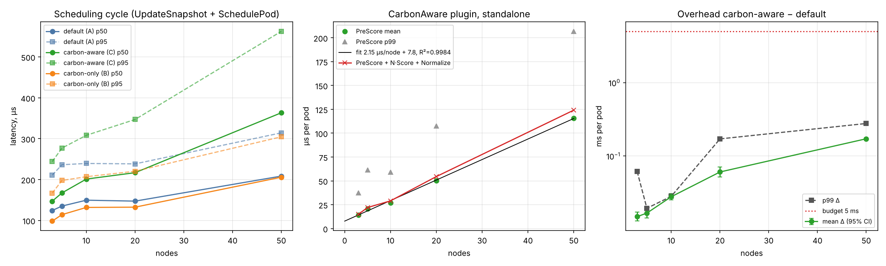
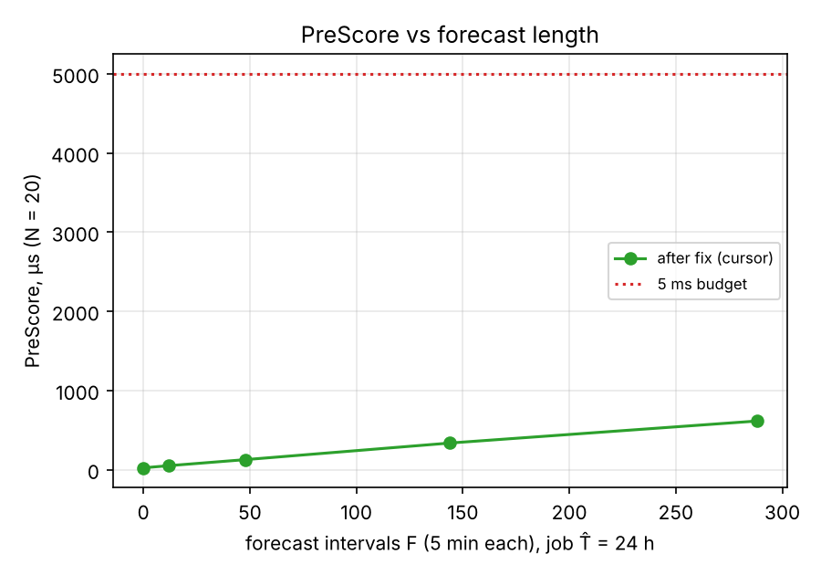
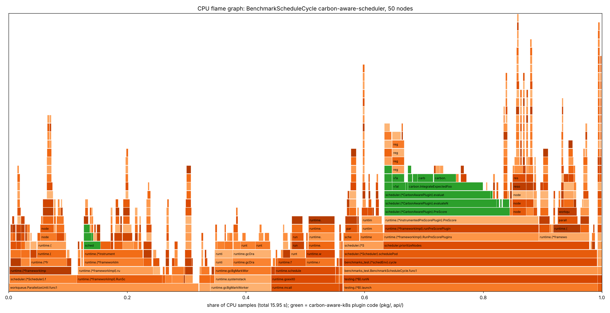

# Quality Gate 9: производительность и масштабируемость планировщика

- **Дата:** 2026-10-18
- **Роль:** Principal Performance Architect / Go Profiling Expert (T9.2), по результатам T9.1
- **Статус:** **PASS** (с оговорками из §8)
- **Решение:** Stage 9 завершён, Stage 10 (научные эксперименты) разблокирован.
- **Сырые данные:** [`benchmarks/results_latency.json`](../../benchmarks/results_latency.json), [`benchmarks/bench_raw.txt`](../../benchmarks/bench_raw.txt), `benchmarks/results_load_*.json`, профили и графики в [`evidence/gate9/`](evidence/gate9/).
- **Воспроизведение:** `make bench` (только `testing.B`) или `make bench-report` (весь конвейер, около 6 минут на 4 vCPU).

## 1. Итоговый вердикт

| Критерий | Требование | Измерено | Итог |
| --- | --- | --- | --- |
| Накладные расходы плагина, 20 нод (T9.1) | < 5 мс на Pod | Δmean = 0,080 мс (95% ДИ ±0,006), Δp50 = 0,070 мс, Δp99 = 0,171 мс | PASS |
| Статистическая репрезентативность (T9.1) | ≥ 1000 итераций на тест | 3000 циклов на профиль и размер кластера, плюс 300 прогревочных; 5000 замеров на точку расширения | PASS |
| Асимптотика по числу нод (T9.2) | O(N) | PreScore: 2,15 мкс/узел, R² = 0,998 (3…50 нод); Score не зависит от N | PASS |
| Zero-allocation в Score (T9.2) | 0 аллокаций | `Score` и `NormalizeScore`: 0 B/op, 0 allocs/op (было 1 alloc, 64 B) | PASS после исправления |
| Mutex contention (T9.2) | нет горячих блокировок | в коде плагина `sync.Mutex` на пути скоринга нет; 0,034% и 12% (только аллокатор рантайма) от и без того малой задержки | PASS |
| Утечки памяти (T9.2) | нет | +7 КиБ на 30 000 циклов, источник вне плагина (§6); горутины 184 → 12 после остановки | PASS |
| CPU и память под 50 pods/s (T9.1) | замерить | 0,38 ядра и пик 107,5 МиБ RSS на весь процесс; совпадает с default-scheduler в пределах шума | замерено |

В ходе аудита найдены и исправлены два дефекта производительности (§5): квадратичная сложность интеграла CF по длине прогноза и аллокация в `Score`. Без первого исправления критерий 5 мс нарушался бы при максимальном по SSOT прогнозе: PreScore на 20 нодах занимал 17,9 мс.

## 2. Методика

### 2.1. Стенд

- 4 vCPU Intel Xeon @ 2,10 ГГц, 15 ГиБ RAM, Linux, Go 1.26.0, `GOMAXPROCS=4`. Облачная VM, соседи по хосту не контролируются, поэтому профили чередуются внутри каждого раунда (§2.3).
- **Планировщик:** настоящий `k8s.io/kubernetes/pkg/scheduler` v1.37.0, запущенный в процессе теста (`scheduler.New`, informers, scheduler cache, profiles). API-сервер заменён `client-go/kubernetes/fake`.
- **Профили** читаются из производственного ConfigMap [`deployments/kubernetes/scheduler-config.yaml`](../../deployments/kubernetes/scheduler-config.yaml) тем же декодером, что и у `kube-scheduler --config`. К ним добавлен стандартный профиль `default-scheduler` (стратегия A). `carbon-aware-scheduler` (C) состоит из стандартных плагинов и `CarbonAware` с весом 13, `carbon-only-scheduler` (B) содержит только `CarbonAware` в режиме `current-ci`.
- **Углеродные данные:** настоящий CDS (`cache.Cache` + REST) на loopback, 3 зоны (north 80, central 240, west 400 gCO₂e/кВт·ч). Плагин получает снимок через свой Cache Sync Worker, как в кластере. Провайдер отдаёт 12 пятиминутных интервалов прогноза, поэтому PreScore выполняет полный кусочный интеграл (2.10s), а не упрощение persistence.
- **Узлы:** 16 CPU, 64 ГиБ, зоны по кругу north/central/west, на каждом один резидентный Pod (500…1500m CPU). **Pod:** 100m CPU, 128 МиБ, `expected-duration=3600s`, `sla-deadline=14400s`.

### 2.2. Что измеряется

1. **Scheduling cycle** (`BenchmarkScheduleCycle`, `TestLatencyReport`): `Cache.UpdateSnapshot` + `Scheduler.SchedulePod`, то есть PreFilter, Filter, PreScore, Score, NormalizeScore и выбор узла. Это та же часть цикла, что попадает в метрику `scheduler_scheduling_algorithm_duration_seconds`. Pod не связывается (bind), поэтому состояние кластера одинаково во всех итерациях. `PodSignature` не задаётся, так что opportunistic batching не сокращает цикл ни одному профилю.
2. **Точки расширения плагина** отдельно (`BenchmarkScheduleScorePerNode`, `…PreScore`, `…NormalizeScore`): экземпляр с производственными аргументами и снимком из того же CDS.
3. **Нагрузка 50 pods/s** (`TestLoad50PodsPerSecond`): `sched.Run`, 1500 Pod за 30 с на 20 нод, отдельный процесс на каждый профиль. Задержка считается от `Create` до вызова `pods/binding`.
4. **PreScore от длины прогноза F** (`BenchmarkSchedulePreScoreForecast`): N = 20, задача на 24 ч, F ∈ {0, 12, 48, 144, 288}.

### 2.3. Статистика

На каждый размер кластера: 300 прогревочных раундов, затем 3000 раундов. В каждом раунде выполняется по одному циклу каждого профиля, порядок сдвигается по кругу, так что дрейф (GC, частота CPU, соседи) попадает на все профили одинаково. Квантили считаются линейной интерполяцией (тип 7). Для разницы средних приводится 95% доверительный интервал Уэлча. Score длится около 0,2 мкс, поэтому один замер Score равен среднему по 200 вызовам: сам `time.Now` стоит около 30 нс.

## 3. Результаты T9.1: задержки

### 3.1. Полный цикл планирования, мкс (3000 циклов на ячейку)

| Ноды | Профиль | mean | p50 | p90 | p95 | p99 |
| ---: | --- | ---: | ---: | ---: | ---: | ---: |
| 3 | default (A) | 133,6 | 124,3 | 180,0 | 210,7 | 372,5 |
| 3 | carbon-aware (C) | 159,2 | 147,1 | 211,5 | 243,9 | 453,5 |
| 3 | carbon-only (B) | 102,4 | 98,4 | 145,7 | 166,8 | 330,2 |
| 5 | default (A) | 149,0 | 135,2 | 201,4 | 236,3 | 412,7 |
| 5 | carbon-aware (C) | 178,9 | 167,3 | 243,4 | 277,0 | 448,6 |
| 5 | carbon-only (B) | 120,2 | 114,2 | 170,9 | 197,9 | 277,9 |
| 10 | default (A) | 159,6 | 149,6 | 215,1 | 239,4 | 390,2 |
| 10 | carbon-aware (C) | 209,7 | 201,2 | 277,5 | 308,3 | 440,7 |
| 10 | carbon-only (B) | 137,4 | 131,9 | 186,7 | 207,0 | 284,9 |
| 20 | default (A) | 159,0 | 147,3 | 211,3 | 238,4 | 367,9 |
| 20 | carbon-aware (C) | 239,4 | 216,9 | 308,8 | 347,0 | 539,0 |
| 20 | carbon-only (B) | 143,8 | 132,5 | 191,6 | 220,4 | 361,8 |
| 50 | default (A) | 221,7 | 208,5 | 279,4 | 314,3 | 491,8 |
| 50 | carbon-aware (C) | 393,5 | 363,4 | 506,9 | 562,5 | 769,3 |
| 50 | carbon-only (B) | 218,2 | 205,9 | 275,4 | 304,6 | 421,7 |

Профиль C во всех 3000 × 5 циклах выбрал узел зоны north (минимальный CI). Счётчик `carbon_aware_scheduler_fallback_total` за прогон равен 0, то есть ни один цикл не ушёл в нейтральный fallback.

### 3.2. Накладные расходы относительно default-scheduler, мкс

| Ноды | Профиль | Δmean ± 95% ДИ | Δp50 | Δp95 | Δp99 | Δp50, % |
| ---: | --- | ---: | ---: | ---: | ---: | ---: |
| 3 | carbon-aware | 25,6 ± 5,5 | 22,8 | 33,2 | 81,0 | +18% |
| 5 | carbon-aware | 30,0 ± 5,8 | 32,2 | 40,7 | 35,9 | +24% |
| 10 | carbon-aware | 50,1 ± 3,7 | 51,7 | 68,9 | 50,6 | +35% |
| **20** | **carbon-aware** | **80,4 ± 6,0** | **69,6** | **108,6** | **171,1** | **+47%** |
| 50 | carbon-aware | 171,8 ± 5,8 | 154,9 | 248,2 | 277,5 | +74% |
| 20 | carbon-only | −15,2 ± 4,1 | −14,8 | −18,0 | −6,1 | −10% |

При 20 нодах накладные расходы равны 0,08 мс в среднем и 0,17 мс на p99. Это в 29 раз ниже бюджета 5 мс. Относительный прирост заметен (+47% к p50), потому что сам цикл короткий: абсолютная задержка carbon-aware профиля на 20 нодах 0,22 мс (p50). Профиль B быстрее A: в нём отключены все стандартные score-плагины, а `CarbonAware` в режиме `current-ci` не считает интеграл.

### 3.3. Точки расширения плагина отдельно, мкс (5000 замеров)

| Ноды | PreScore mean / p50 / p95 / p99 | Score, на узел (mean / p99) | NormalizeScore | Сумма PreScore + N·Score + Normalize (mean / p99) |
| ---: | --- | --- | ---: | --- |
| 3 | 14,2 / 13,7 / 21,1 / 37,6 | 0,19 / 0,42 | 0,22 | 15,0 / 39,1 |
| 5 | 20,9 / 20,8 / 29,0 / 61,4 | 0,18 / 0,37 | 0,21 | 22,0 / 63,5 |
| 10 | 27,1 / 23,0 / 41,8 / 59,3 | 0,17 / 0,34 | 0,19 | 29,0 / 62,9 |
| 20 | 50,2 / 46,3 / 73,3 / 107,5 | 0,20 / 0,39 | 0,24 | 54,5 / 115,5 |
| 50 | 115,8 / 109,5 / 154,8 / 206,7 | 0,16 / 0,28 | 0,31 | 124,1 / 221,1 |

`testing.B` из [`bench_raw.txt`](../../benchmarks/bench_raw.txt): Score 173–190 нс/оп, 0 B/op, 0 allocs/op для всех N; PreScore 9,5 / 16,4 / 27,0 / 49,2 / 130,6 мкс при 3 / 5 / 10 / 20 / 50 нодах, 16–20 аллокаций на Pod (не на узел).

На 20 нодах сам плагин стоит 54 мкс, а прирост полного цикла 80 мкс. Остальные ~25 мкс приходятся на работу фреймворка с ещё одним score-плагином: параллельный вызов Score по узлам, NormalizeScore и умножение на вес. Это цена любого out-of-tree score-плагина, а не логики `CarbonAware`.

### 3.4. CPU и память под нагрузкой 50 pods/s (20 нод, 1500 Pod, 30 с)

| Профиль | Связано | Пропускная способность | Create→Bind p50 / p95 / p99, мс | CPU процесса, с (ядер в среднем) | Heap пик / среднее, МиБ | RSS пик, МиБ | Heap после GC, МиБ |
| --- | ---: | ---: | --- | --- | --- | ---: | ---: |
| default (A) | 1500/1500 | 50,03 Pod/s | 2,14 / 4,30 / 6,88 | 11,16 (0,371) | 56,9 / 26,8 | 109,7 | 4,79 |
| carbon-aware (C) | 1500/1500 | 50,03 Pod/s | 2,27 / 4,79 / 8,44 | 11,44 (0,381) | 55,6 / 26,5 | 107,5 | 4,91 |
| carbon-only (B) | 1500/1500 | 50,03 Pod/s | 2,11 / 4,21 / 6,66 | 10,98 (0,366) | 56,3 / 26,1 | 108,7 | 4,87 |

Все три профиля держат 50 Pod/s без очереди. CPU и память совпадают в пределах шума. Ожидаемая разница по CPU мала: 0,08 мс × 50 Pod/s ≈ 0,004 ядра, что меньше разброса между прогонами. Важная оговорка: цифры CPU и RSS относятся ко всему тестовому процессу, где кроме планировщика работают fake API-сервер (object tracker, watch) и генератор нагрузки. Поэтому это верхняя граница для kube-scheduler, а осмысленна только разница между профилями. Выбор зон: A распределил Pod по north/central/west как 35/35/30%; C отправил 70% в north, остальное в central, после того как узлы north заполнились по CPU.

## 4. Результаты T9.2: масштабируемость

Линейная регрессия по 5 точкам (N = 3, 5, 10, 20, 50), [`scaling_fit.json`](evidence/gate9/scaling_fit.json):

| Величина | Наклон | Свободный член | R² | Показатель степени (log-log) |
| --- | ---: | ---: | ---: | ---: |
| PreScore (mean) | 2,15 мкс/узел | 7,8 мкс | 0,998 | 0,73 |
| PreScore + N·Score + Normalize | 2,31 мкс/узел | 8,2 мкс | 0,999 | 0,74 |
| Накладные расходы цикла C − A (mean) | 3,12 мкс/узел | 16,7 мкс | 0,999 | 0,69 |
| Цикл, carbon-aware (mean) | 4,82 мкс/узел | 151,4 мкс | 0,993 | 0,31 |
| Цикл, default (mean) | 1,70 мкс/узел | 134,6 мкс | 0,949 | 0,16 |

Линейная модель описывает время плагина с R² ≥ 0,998. Показатель степени в log-log меньше 1, потому что постоянная часть (разбор аннотаций, загрузка снимка, запись CycleState) на малых N ещё сравнима с линейной. Признаков сверхлинейного роста нет. По коду: PreScore делает один проход по узлам (`evaluateNodes`: один `snapshot.Load`, затем для каждого узла P(u) и интеграл), затем второй линейный проход для min-max нормализации; Score выполняет поиск в map за O(1); NormalizeScore проходит список один раз. Итого **O(N) по числу узлов**.

Вторая размерность, длина прогноза F, до аудита давала O(F²) на каждый узел (§5.1). После исправления:

| F (интервалов по 5 мин) | 0 | 12 | 48 | 144 | 288 |
| --- | ---: | ---: | ---: | ---: | ---: |
| PreScore до исправления, мкс ([файл](evidence/gate9/prescore_forecast_before_fix.txt)) | 26,7 | 84,1 | 600,5 | 4787 | 17 897 |
| PreScore после исправления, мкс | 23,2 | 50,5 | 126,9 | 336,5 | 614,2 |

После исправления зависимость от F линейна (2,05 мкс на интервал при N = 20, R² = 0,999), итоговая сложность PreScore O(N·F).

## 5. Найденные и исправленные дефекты

### 5.1. Квадратичный интеграл CF по длине прогноза (критично для бюджета)

`IntegrateExpectedFootprint` для каждой точки разбиения вызывал `ciAt`, а тот линейно просматривал весь прогноз и валидировал каждый интервал: O(F) точек × O(F) поиска. При максимальном по SSOT прогнозе (288 интервалов, 24 ч) и задаче на 24 ч PreScore на 20 нодах занимал **17,9 мс**, в 3,6 раза больше бюджета 5 мс. В профиле CPU `ciAt` давал 35% времени PreScore.

Исправление ([`pkg/carbon/integral.go`](../../pkg/carbon/integral.go)): валидность интервалов вычисляется один раз за вызов. Если валидные интервалы отсортированы и не пересекаются (контракт CDS: `CarbonForecast.Validate` требует строго возрастающих меток), CI для упорядоченных точек разбиения ищется одним курсором вперёд (`ciAtSorted`). В остальных случаях используется прежний `ciAt`. Результат совпадает с прежним побитово: [`integral_cursor_test.go`](../../pkg/carbon/integral_cursor_test.go) сравнивает обе реализации на 2000 случайных прогнозах, включая пересекающиеся, неотсортированные, открытые и невалидные интервалы. `BenchmarkIntegrate288`: 847 → 33,5 мкс (в 25 раз), 0 аллокаций. Оракулы T2.2 (`integral_test.go`) проходят без изменений.

### 5.2. Аллокация на каждом вызове Score и NormalizeScore

`statusSuccess()` возвращал `fwk.NewStatus(fwk.Success)`, а это 64 B в heap на каждый вызов Score (N раз на Pod) и NormalizeScore. Фреймворк трактует `nil *Status` как Success (`Status.Code()` на nil), поэтому теперь возвращается `nil`. Результат: 0 B/op, 0 allocs/op, Score 203 → 180 нс. Новый тест `TestScoreAndNormalizeZeroAlloc` (`testing.AllocsPerRun`) закрепляет требование.

## 6. Профилирование (pprof)

Профили сняты на `BenchmarkScheduleCycle` (carbon-aware, 50 нод, 20 000 циклов) и `BenchmarkSchedulePreScoreParallel` (4 горутины, один экземпляр плагина, один снимок). Файлы `.pprof` открываются командой `go tool pprof -http=: <файл>`.

**CPU** ([top](evidence/gate9/cpu_cycle_carbon50_top.txt), [граф вызовов](evidence/gate9/cpu_cycle_carbon50_graph.svg), [только код проекта](evidence/gate9/cpu_cycle_carbon50_plugin_top.txt)). На 50 нодах `CarbonAwarePlugin` занимает 22,4% всех CPU-сэмплов процесса, из них `IntegrateExpectedFootprint` 12,6%, разбор метки зоны (`ParseNodeEnergyIdentity`, regexp) 2,3%. Остальное приходится на стандартные плагины Filter/Score, параллелизатор фреймворка и GC (10%). Горячих точек вне ожидаемого (интеграл на каждый узел) нет.

**Heap** ([alloc_space](evidence/gate9/heap_cycle_carbon50_alloc_top.txt), [код проекта](evidence/gate9/heap_cycle_carbon50_plugin_alloc_top.txt), [inuse](evidence/gate9/heap_cycle_carbon50_inuse_top.txt)). Код проекта даёт 11% выделенных байт цикла: `evaluateNodes` (срез `nodeWork`), `writeDecisionWorks` (map оценок для PostBind) и `assembleCycleState` (map `ScorePerNode`). Это по 1 структуре на Pod с размером O(N), их требует контракт CycleState. Число аллокаций на Pod постоянно (16–20) и от N не зависит; на путях, вызываемых для каждого узла (Score, NormalizeScore, цикл по узлам), аллокаций нет.

**Mutex и block** ([mutex цикла](evidence/gate9/mutex_cycle_carbon50_top.txt), [mutex PreScore ×4](evidence/gate9/mutex_prescore_parallel_top.txt), [block](evidence/gate9/block_prescore_parallel_top.txt)). Снимок углеродных данных публикуется через `atomic.Pointer` и читается без блокировок; `staleWarnMu` берётся только в режиме stale. В профиле цикла на код проекта приходится 0,01 мс из 44 мс суммарного ожидания мьютексов за 20 000 циклов. Остальное ожидание в fake-клиенте и informers. В параллельном PreScore на 4 горутинах за 5 с (около 21 с процессорного времени горутин) на стеки плагина приходится 8,8 мс ожидания, и всё это `runtime.unlock` внутри аллокатора (`maps.NewMap`), а не `sync.Mutex` плагина. Параллельный PreScore масштабируется: 35 мкс/оп при 4 горутинах против 131 мкс последовательно.

**Утечки.** После прогрева выполнено 30 000 циклов carbon-aware на 50 нодах; через каждые 5000 циклов принудительный GC и замер живого heap: 12,366 → 12,373 МиБ (+7 КиБ, 3 КиБ на 10 000 циклов), число горутин неизменно (913). Разница heap-профилей до и после 60 000 циклов (MemProfileRate = 1) показывает +17,8 КБ, источники которых вне плагина: ленивая таблица `crc32` (8 КБ, однократная), ожидания `WaitGroup` и HTTP-соединения Worker. В коде `carbon-aware-k8s/pkg` роста нет. Под нагрузкой 50 pods/s heap после остановки и GC возвращается к 4,8–4,9 МиБ (база 5,8 МиБ), горутины 184 → 12. Серии метрик ограничены метками зон и точек расширения, поэтому их число не растёт с числом Pod.

## 7. Изменения кода в этом этапе

| Файл | Изменение |
| --- | --- |
| `benchmarks/harness_test.go` | стенд: in-process kube-scheduler с профилями из ConfigMap, fake API, CDS на loopback, статистика |
| `benchmarks/latency_benchmark_test.go` | `BenchmarkSchedule*`, отчёт `TestLatencyReport` → `results_latency.json`, стабильность heap |
| `benchmarks/load_test.go` | нагрузка 50 pods/s, CPU (getrusage), heap (runtime/metrics), RSS (VmHWM) |
| `benchmarks/run_benchmarks.sh`, `plot_results.py`, `Makefile` (`bench`, `bench-report`) | конвейер, pprof, графики, регрессия |
| `pkg/carbon/integral.go`, `integral_cursor_test.go` | O(F) курсор вместо O(F²), тест побитовой эквивалентности |
| `pkg/scheduler/plugin.go`, `score_bench_test.go` | `nil` Success, тест zero-alloc |

`go vet ./...` и `go test -race -count=1 ./...` (unit, integration, e2e-пакет без тега) проходят. E2E против kind в этом этапе не перезапускались: изменения не трогают манифесты и решения планировщика (интеграл совпадает побитово, `nil` равнозначен Success).

## 8. Оговорки и рекомендации

1. **Нет сетевой задержки API-сервера.** API заменён fake-клиентом. Задержка цикла (алгоритм) от этого не зависит, а задержка Create→Bind и CPU процесса в реальном кластере будут выше для всех профилей одинаково. Замер CPU именно контейнера `carbon-aware-scheduler` в kind через cAdvisor стоит сделать в Stage 10, где раннер и так собирает метрики из Prometheus.
2. **CPU и RSS относятся ко всему процессу** (§3.4), это верхняя граница, а не чистое потребление kube-scheduler.
3. **Синтетические узлы и прогноз.** 12 интервалов прогноза в основном замере близки к Replay-сценарию volatile (5-минутный шаг, горизонт 1 ч). Худший случай F = 288 вынесен в отдельный бенчмарк (§4).
4. **Opportunistic batching.** В k8s 1.37 эта функция (beta, включена по умолчанию) переиспользует результаты фильтрации для одинаковых Pod, только если все Filter/Score-плагины профиля реализуют `SignPlugin`. `CarbonAware` его не реализует, поэтому в реальном потоке одинаковых Pod профиль C теряет эту оптимизацию, а A её получает. В замере цикла batching выключен для всех профилей (§2.2), в нагрузочном тесте на 50 pods/s разницы в задержке Create→Bind не видно. Реализовать `SignPod` можно позже, если эксперименты покажут разницу.
5. **Дальнейшие оптимизации (не требуются для Gate 9):** интеграл ∫CI dt одинаков для всех узлов одной зоны в рамках одного PreScore, кэш по зоне снял бы ~55% PreScore на 50 нодах (O(N + Z·F) вместо O(N·F)), но слегка меняет порядок операций с плавающей точкой; regexp в `ZoneID.Validate` (2,3% CPU) можно заменить ручной проверкой.

## 9. Заключение

Накладные расходы `CarbonAware` при 20 нодах равны 0,08 мс в среднем и 0,17 мс на p99, что многократно ниже бюджета 5 мс. Время плагина растёт линейно по числу нод (2,2 мкс/узел, R² = 0,998), Score и NormalizeScore не аллоцируют память, конкуренции за мьютексы в коде плагина нет, утечек не обнаружено. Два найденных дефекта (O(F²) в интеграле и аллокация в Score) исправлены с тестами.

**QUALITY GATE 9: PASS. Stage 10 (научные эксперименты) разблокирован.**
