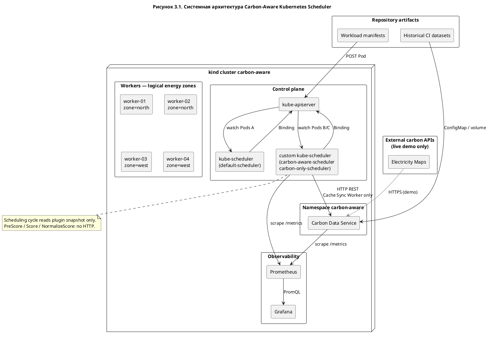
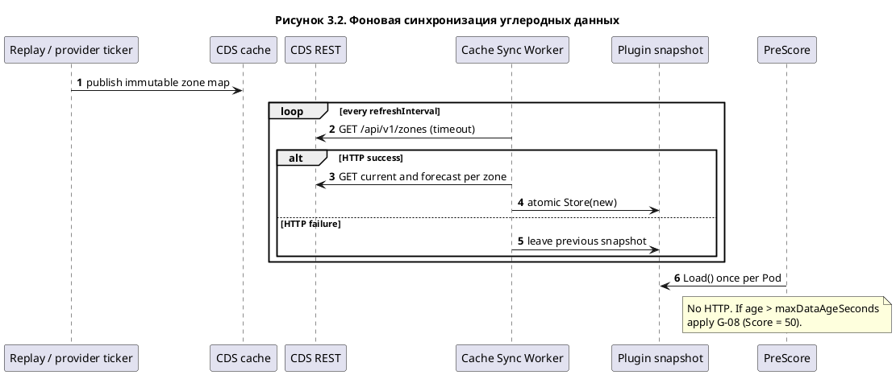
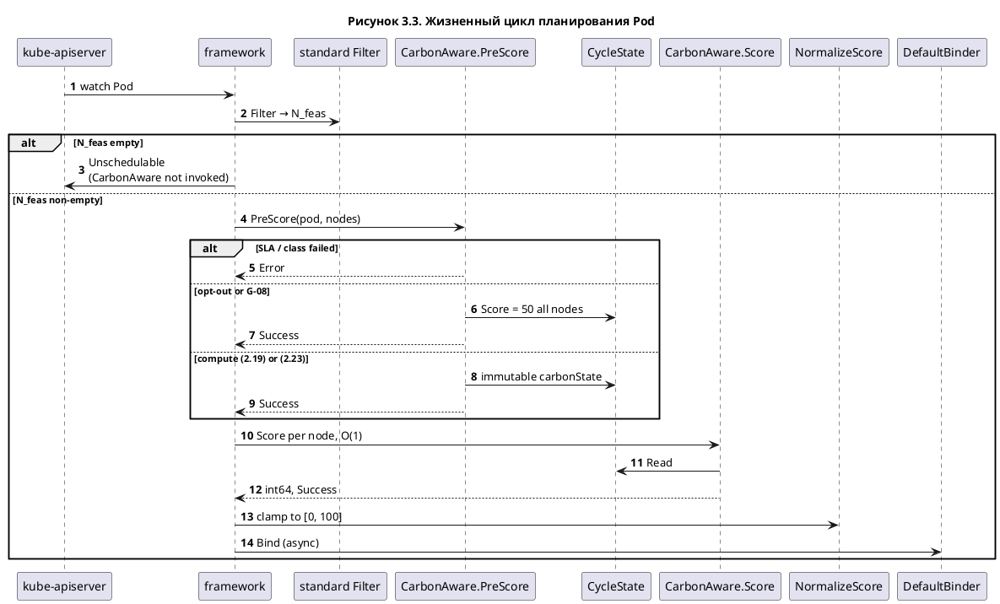
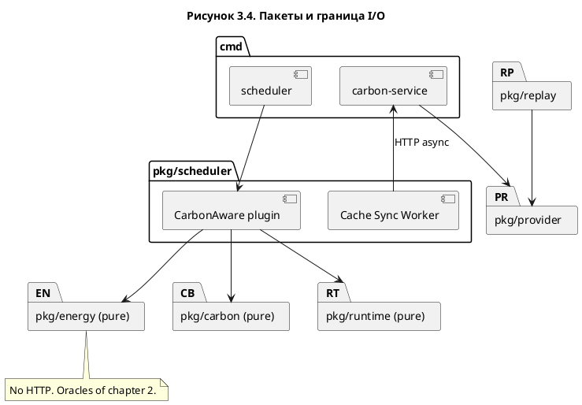

# Глава 3. Архитектура и проектирование углеродо-ориентированного планировщика

- **Редакционный статус:** черновик после Quality Gate 3; компонентная модель тождественна заблокированному SSOT
- **Контрольная точка:** Quality Gate 3 — PASS; ADR-002 — accepted; Freeze — accepted
- **Канон:** [`docs/ssot/01_architecture_ssot.md`](../ssot/01_architecture_ssot.md) v1.1.0 (LOCKED);
  контракты [`docs/ssot/03_api_contracts_ssot.md`](../ssot/03_api_contracts_ssot.md) v1.0.1;
  Fallback [`docs/ssot/failure_and_fallback_policy.md`](../ssot/failure_and_fallback_policy.md) v1.1.0
- **Дата:** 2026-09-04
- **Область проектирования:** первоначальное размещение Pod в одном кластере Kubernetes
  без синхронного ввода-вывода на горячем пути планировщика

Глава отвечает на вопрос, оставленный главой 2 открытым: каким составом процессов, пакетов и
контрактов реализовать заблокированные уравнения (2.1)–(2.23), не нарушив семантику Kubernetes
Scheduler Framework и запрет сетевых вызовов в фазах `PreScore` / `Score` / `NormalizeScore`.
Формулы в настоящей главе не переопределяются. Утверждения о численном эффекте стратегий A/B/C
на стенде являются гипотезой.

## 3.1. Постановка архитектурной задачи

### 3.1.1. Что должна делать система

При появлении нового Pod система выбирает узел из множества, уже прошедшего стандартный
Kubernetes `Filter`, минимизируя ожидаемый маржинальный углеродный след \(\widehat{CF}(p,n)\)
на горизонте \(\hat T\) при соблюдении SLA и ресурсного предпочтения \(S_R\). Это ровно постановка
главы 2. Решение принимается только при первичном размещении: уже запущенный Pod не перемещается.

Архитектура обязана одновременно удовлетворить трём классам ограничений. Первый — математический:
арифметика (2.10) и min-max (2.15) требуют знания всего множества кандидатов, поэтому не могут
жить в поузловом `Score`. Второй — контракт фреймворка: `Score` вызывается параллельно,
`NormalizeScore` видит только пары «имя узла → целое», а код `Error` из `PreScore`/`Score`
отклоняет попытку планирования. Третий — экспериментальный: стратегии A, B и C сравниваются на
одной топологии и одном ряде \(CI\), различаясь только алгоритмом ранжирования.

### 3.1.2. Почему нельзя вызывать внешний API из цикла планирования

Цикл планирования одного Pod в kube-scheduler сериализован относительно других Pod. Сетевой
вызов внутри `Score` или даже однократный HTTP в `PreScore` превращает задержку Carbon Data
Service в задержку всего кластера. Scheduler Extender был бы синхронным HTTP-webhook на каждую
попытку и прямо запрещён границами работы. Поэтому углеродные данные попадают в плагин только
через локальный in-memory снимок, который обновляет фоновый Cache Sync Worker.

Горячий путь выполняет lookup и целочисленное приведение. Суммирование по сетке \(CI\) имеет
сложность \(O(NK)\) и выполняется один раз в `PreScore`. Фаза `Score` остаётся \(O(1)\) на узел.

### 3.1.3. Углерод как предпочтение, а не как допустимость

Узел в зоне с высокой \(CI\) остаётся работоспособным. Отсев на собственном `Filter` при «грязных»
данных во всех зонах остановил бы планирование и сделал бы множество \(\mathcal{N}_{\mathrm{feas}}\)
у стратегий A и C различным. Поэтому плагин реализует исключительно `PreScore`, `Score` и
`NormalizeScore`. Точки `Filter`, `QueueSort` и `Permit` не используются; `Reserve` не вводится.

Hard SLA (2.13) проверяется в `PreScore` кодом `Error` с сообщением `SLA precondition failed`.
Это отказ конфигурации нагрузки, а не углеродный Fallback и не `Score=0`: нуль ранжирует узел,
но не исключает его из выбора фреймворка.

## 3.2. Компонентная модель

Система состоит из двух пользовательских процессов runtime и стандартной плоскости Kubernetes.

| Процесс | Бинарь | Роль |
| --- | --- | --- |
| Carbon Data Service | `cmd/carbon-service` | нормализация \(CI\), replay, кэш, REST |
| Custom kube-scheduler | `cmd/scheduler` | плагин `CarbonAware` в профилях B и C |
| kube-scheduler (kind) | образ control-plane | профиль `default-scheduler` (стратегия A) |

Carbon Data Service не принимает решений о размещении. Custom-планировщик не обращается к
внешним Carbon API. Python-анализ не является runtime-процессом.

Два независимых in-memory кэша разделяют контуры. Кэш CDS хранит нормализованные current и
forecast по зонам. Снимок плагина — второй, неизменяемый после публикации указатель, с которого
`PreScore` делает ровно один `Load()` на Pod. Даже если Worker опубликует новый снимок посреди
параллельного `Score`, текущий Pod продолжает считать по указателю, уже зафиксированному в
`CycleState`.

Инварианты рисунка 3.1: единственная стрелка custom-планировщика к CDS подписана Cache Sync
Worker; Electricity Maps не имеет ребра к планировщику; Prometheus не запрашивается из цикла
планирования.

## 3.3. Carbon Data Service

Отдельный процесс готовит достоверное состояние \(CI\). На стенде один экземпляр, порт HTTP 8080,
без реплик и autoscaling. Точка входа — `cmd/carbon-service`.

### 3.3.1. Адаптеры провайдеров

Узкий интерфейс `CarbonProvider` объявляется на стороне потребителя. Три реализации закрывают
обязательный состав источников: `MockProvider` для тестов, `HistoricalDatasetProvider` через
Replay Engine для зачётных прогонов и `ElectricityMapsProvider` только для демонстрации. Адаптер
возвращает канонический `CarbonRecord` в единице `gCO2e/kWh` (average consumption-based lifecycle)
либо ошибку. Смешение direct и lifecycle в одном снимке запрещено. Пакет `pkg/provider` не
импортирует `pkg/scheduler`.

### 3.3.2. Replay Engine

Пакет `pkg/replay` воспроизводит ряд \(CI(z,t)\) по модельному времени сценария, а не по
wall-clock. На запрос current возвращается кусок сетки, содержащий \(t_{\mathrm{model}}\). На
запрос forecast — последующие куски из того же файла, если они помечены как forecast; иначе
пустой ряд. Persistence (2.11) выполняется в плагине, а не подменой будущих actual. Perfect
foresight в зачётном прогоне запрещён. Для CDS replay выглядит как ещё один `CarbonProvider`.

### 3.3.3. Кэш и REST

Кэш внутрипроцессный. Ключ — идентификатор зоны. Запись допускается только после проверки
домена \(CI\in[0,2000]\,\mathrm{gCO_2e}/\mathrm{kWh}\). При ошибке провайдера сохраняется последний
валидный снимок с пометкой stale; частичная публикация карты зон запрещена.

Нормативные пути:

| Метод | Путь | Назначение |
| --- | --- | --- |
| GET | `/api/v1/zones` | каталог зон текущего снимка |
| GET | `/api/v1/zones/{zone}/current` | текущий `CarbonRecord` |
| GET | `/api/v1/zones/{zone}/forecast` | ряд прогноза |
| GET | `/api/v1/health` и `/api/v1/healthz` | liveness/readiness + freshness |
| GET | `/metrics` | Prometheus |

CDS не предоставляет endpoint «посчитать Score» или «выбрать node». GET идемпотентен и не
двигает модельные часы. Неизвестная зона даёт 404; плагин трактует это как отсутствие зоны у
соответствующих узлов, а не как падение планировщика. Пустой кэш после рестарта — 503; Worker
не затирает свой последний хороший снимок.

Единица измерения на проводе обязательна. Единственный формат времени JSON — RFC 3339 UTC с
секундной точностью. Unix-секунды остаются внутренним представлением модели.

## 3.4. Плагин `CarbonAware`

Бинарь `cmd/scheduler` — это kube-scheduler с одним дополнительным плагином, а не собственный
планировщик. На стенде он разворачивается вторым Pod рядом с kind `kube-scheduler`. Leader
election у второго экземпляра выключен.

### 3.4.1. Compile-time контракт

Плагин реализует `Plugin`, `PreScorePlugin`, `ScorePlugin` и `ScoreExtensions`. Он не реализует
`FilterPlugin`, `PermitPlugin`, `QueueSortPlugin`. Фабрика декодирует `pluginConfig.args`,
проверяет домен мощности (2.2a) и симплекс весов (2.20) и при нарушении не стартует. Cache Sync
Worker запускается в goroutine с отменой по контексту фабрики. `context.Context` в полях
структуры плагина не хранится.

### 3.4.2. Cache Sync Worker

Единственный HTTP-клиент процесса планировщика к CDS. Период опроса и таймаут читаются из args
(канон стенда: 30 s и 2 s). Тик забирает каталог зон, затем current и forecast. Если хотя бы
один обязательный GET тика неуспешен, новый снимок не публикуется. Валидные записи собираются в
неизменяемый `carbonSnapshot`; публикация атомарна. Worker не вызывается из `PreScore`/`Score`.
Нет ожидания «кэш готов» на горячем пути: пустой снимок обрабатывается как G-08.

### 3.4.3. Порядок `PreScore`

Один вызов на Pod, все допустимые узлы разом. Нормативный порядок:

1. Разбор labels/annotations в `WorkloadProfile`. Невалидный opt-in — `Error`.
2. Если `carbon-aware.io/enabled` не равен `"true"` — всем узлам Score 50, `Success`, режим
   `opt_out`. Это не G-08: углеродный скоринг сознательно выключен, метрика Fallback не растёт.
3. Разрешение горизонта \(\hat T\): явная длительность, иначе таблица класса, иначе класс по
   умолчанию. Если горизонт не определён — G-20, `Error`.
4. Hard SLA (2.13). Нарушение — `Error`; `Score` не вызывается.
5. Один `Load()` снимка. Дальше — либо G-08 (нейтраль 50 всем), либо полный расчёт (2.10)/(2.23)
   и (2.19) с предохранителями G-06, G-09, G-10, G-21.
6. Запись неизменяемого `carbonState` в `CycleState`.

Режим `scoringMode: current-ci` (стратегия B) считает (2.23), а не (2.19) с \(w_C=1\) на
\(\widehat{CF}\). Паника запрещена.

### 3.4.4. `Score` и `NormalizeScore`

`Score` читает `carbonState` и возвращает готовое fixed-point значение. Нет аллокаций карт, нет
повторного `Load()`, нет HTTP. Отсутствие ключа — дефект `PreScore`; безопасный ответ — нейтраль
и `Success`, не `Error`.

`NormalizeScore` выполняет приведение (2.21): округление \(s^{\mathrm{fp}}/100\) и ограничение
интервалом \([0,100]\). Min-max \(S_C\) сюда переносить нельзя: физические величины на этой фазе
недоступны. После нормализации фреймворк считает `TotalScore` (2.22). Вес плагина в
`KubeSchedulerConfiguration` не следует путать с внутренним \(w_C\).

Привязку выполняет стандартный `DefaultBinder`. Плагин не держит ссылку на `CycleState` после
попытки: состояние невалидно после завершения цикла.

## 3.5. Потоки данных

Два контура независимы. Стрелка «использует» из scheduling cycle в CDS запрещена.

| Контур | Триггер | I/O | Писатель | Читатель |
| --- | --- | --- | --- | --- |
| A. Обновление углерода | ticker CDS и Worker; шаг \(t_{\mathrm{model}}\) | HTTP наружу только у CDS (demo); HTTP CDS←Worker | кэш CDS; snapshot плагина | REST; Worker |
| B. Планирование Pod | watch apiserver | только API Kubernetes | `CycleState` | `PreScore` пишет, `Score` читает |
| C. Наблюдаемость | scrape Prometheus | `/metrics` | экспортёры | Prometheus, Grafana |
| D. Ex-post KPI | после прогона | TSDB, Binding | анализ Python | диплом |

Контур D не питает `Score`. Утилизация для \(u_n^{\pm}\) берётся из снимка планировщика
(`NodeInfo.GetRequested()` / allocatable), не из cAdvisor.

На рисунке 3.2 нет сообщения `PreScore → REST` и нет `Score → *`.

Согласованность с моделью: `Filter` задаёт \(\mathcal{N}_{\mathrm{feas}}\); SLA в `PreScore`
задаёт \(\mathcal{N}_{\mathrm{SLA}}\); G-08 гасит итоговый Score целиком; Bind углерод не
пересчитывает.

## 3.6. Изоляция стратегий A, B и C

Сравнение должно идти в одном кластере, на тех же узлах и том же ряде \(CI\). Различающий фактор —
алгоритм ранжирования. Механизм Kubernetes — поле `spec.schedulerName`.

| Стратегия | `schedulerName` | Процесс | `CarbonAware` | Прочие Score | Режим |
| --- | --- | --- | --- | --- | --- |
| A | `default-scheduler` | kind kube-scheduler | нет | стандарт 1.37 | — |
| B | `carbon-only-scheduler` | custom | да | Score/PreScore default выключены | `current-ci` (2.23) |
| C | `carbon-aware-scheduler` | custom | да | стандарт 1.37 сохранены | `expected-cf` (2.19) |

Custom-бинарь не объявляет профиль `default-scheduler`, чтобы не конкурировать с kind scheduler
за имя и лидерство. Стратегия B вынесена в третий профиль того же бинаря: иначе B и C делили бы
очередь и `pluginConfig`.

Регистрация B через `multiPoint` с последующим `score.disabled: ['*']` в Kubernetes 1.37
некорректна: проверка `disabled: '*'` обрывает развёртку `multiPoint` до включения явно
перечисленного плагина, и `CarbonAware` исчезает из `Score`. Норма: регистрировать плагин явно в
`preScore` и `score`. `Filter` остаётся стандартным.

Вес фреймворка \(w_{\mathrm{CA}}^{\mathrm{fw}}\) для профиля C — отдельный экспериментальный
рычаг (стартовая гипотеза 13, равная сумме default Score weights 1.37). Он не равен \(w_C\).
Молчаливый вес 1 запрещён как скрытый параметр.

## 3.7. Контракты API и метаданных

Группа `carbon-aware.io/v1alpha1`. CRD в состав работы не входит: политика задаётся args плагина
и ключами `carbon-aware.io/*`.

Каждый ключ имеет ровно одну поверхность. Opt-in — label `carbon-aware.io/enabled` со значениями
`"true"` и `"false"`; отсутствие ключа эквивалентно `"false"`. Класс нагрузки — label из закрытого
словаря `batch` / `flexible` / `latency-sensitive`. Ожидаемая длительность и относительный дедлайн —
annotations со строкой Go duration (`1800s`, не голое `300` и не RFC 3339). Относительный дедлайн
есть \(T_{\mathrm{deadline}}\) модели, отсчитываемый от момента попытки.

Зона узла — label `carbon-aware.io/zone`. Узел без зоны не исключается: \(S_C=1/2\), вклад в
\(CF_{\min},CF_{\max}\) не входит. Невалидный идентификатор зоны трактуется так же.

`CycleState` ключ — `carbon-aware.io/CarbonAware`. Payload неизменяем после `Write`; `Clone()`
возвращает тот же указатель. Кэш \(CI\) в `CycleState` не хранится: он живёт в снимке плагина.

Машиночитаемая спецификация REST — `api/v1alpha1/openapi.yaml`. Тело ошибки — Kubernetes `Status`.

## 3.8. Отказы, деградация и Anti-Thrashing

Гарантия деградации: любой отказ плоскости углеродных данных не превращает ресурсно допустимый
Pod в `Unschedulable` и не даёт из `Score` код, отличный от `Success`.

Автомат снимка на Pod:

| Состояние | Предикат | Score |
| --- | --- | --- |
| SM-FRESH | валидный снимок, возраст \(\le\) `staleWarnSeconds` | полный (2.19) или (2.23) |
| SM-STALE | возраст ещё \(\le\) `maxDataAgeSeconds`, но данные stale | тот же полный Score + Warning |
| SM-DEAD / SM-EMPTY | нет снимка или возраст \(>\) `maxDataAgeSeconds` | 50 всем (G-08) |

«Penalty» для stale-in-window не вводит множитель и не меняет формулы. Penalty — журнал, метрика
и флаг качества. Неформальная трактовка \(S_C=0\) как нейтрали запрещена: канон \(S_C^{\mathrm{neutral}}=1/2\),
\(\operatorname{Score}_{\mathrm{neutral}}=50\).

При G-08 вклад `CarbonAware` одинаков для всех кандидатов, поэтому argmax `TotalScore` совпадает
с argmax без углеродного плагина. Это и есть возврат к baseline. Отключать только \(S_C\), оставляя
\(S_R\) внутри плагина, нельзя: профиль C тогда не вернулся бы к стандартному ранжированию.

Resource exhaustion (\(\mathcal{N}_{\mathrm{feas}}=\varnothing\)) — ответственность стандартного
`Filter`. Плагин в этом случае не вызывается.

Anti-thrashing размещения не вводит descheduler и cooldown relocation. Растекание burst-нагрузки
обеспечивают \(S_R\) (2.17), последовательный assume следующего Pod и жёсткий `NodeResourcesFit`.
Стратегия B с \(w_R=0\) и выключенными прочими Score-плагинами сохраняет концентрацию на минимуме
\(CI\) до насыщения Filter — это принятое свойство наивного baseline, а не дефект реализации.

## 3.9. Наблюдаемость и экспериментальный стенд

Имена метрик стабильны. Префикс проекта — `carbon_aware_`. Счётчик Fallback с лейблом `reason`
фиксирует только G-08 (`empty`, `dead`, `all_invalid`). Stale-in-window и opt-out имеют отдельные
счётчики, иначе эксперимент отказа источника смешается с выключенным скорингом и с предупреждением
о свежести.

Для измерения overhead используется несэмплируемая
`scheduler_framework_extension_point_duration_seconds`. Cluster \(CF\) считается офлайн по (2.9a)
и не подменяет \(\widehat{CF}(p,n)\).

Стенд — kind-кластер `carbon-aware`: один control-plane и не менее четырёх worker. География
моделируется label зоны. Канон по умолчанию: два узла `north` и два узла `west`, чтобы отделить
эффект \(CI\) от эффекта \(S_R\). Узлы считаются всегда включёнными; \(P_{\mathrm{idle}}\) и
\(P_{\max}\) — конфигурация сценария, не показание RAPL kind-node. NetworkPolicy разрешает
планировщику доступ к CDS :8080 и запрещает Worker-узлам ходить в Electricity Maps.

## 3.10. Раскладка пакетов

Чистые пакеты `pkg/energy`, `pkg/carbon`, `pkg/runtime` не зависят от провайдеров и не импортируют
`cmd/*`. Стрелка плагина к REST отсутствует: её имеет только Worker. Это уточняет дерево каталогов
входной спецификации, чтобы I/O не просочился в unit-тесты модели.

## 3.11. Соответствие фаз планировщика математической модели

| Модель | Компонент | Запрещено здесь |
| --- | --- | --- |
| (2.2)–(2.4) | `pkg/energy`, вызов из `PreScore` | HTTP; Prometheus |
| (2.10s) | `pkg/carbon` + снимок \(CI\), `PreScore` | суммирование в `Score` |
| (2.11) | `PreScore`, если forecast пуст | perfect foresight |
| (2.13) | `PreScore` Error | `Filter`; `Score=0` |
| (2.14)–(2.19) | `PreScore` (нужен весь \(\mathcal{N}^{\star}\)) | min-max в `NormalizeScore` |
| (2.21) | `NormalizeScore` | изменение относительного порядка |
| (2.22) | код фреймворка | подмена внутри плагина |
| (2.23) | тот же плагин, другой профиль | отдельный бинарь |
| G-08 | `PreScore` пишет 50 всем | отключение только \(S_C\) |
| G-09 | `PreScore` на узел без зоны | `Filter` Unschedulable |

Эталоны главы 2 остаются обязательными unit-тестами чистых функций и не требуют кластера.

## 3.12. Выводы главы

Архитектура углеродо-ориентированного планировщика зафиксирована как двухпроцессная система с
асинхронным контуром углеродных данных. Carbon Data Service нормализует \(CI\) и отдаёт REST;
Custom kube-scheduler принимает решения, читая только локальный снимок. Горячий путь
`PreScore` / `Score` / `NormalizeScore` не выполняет сетевых вызовов. Углерод остаётся критерием
предпочтения. Стратегии A, B и C изолируются полем `schedulerName` на одном кластере. Отказ
источника данных включает нейтральный Score и не останавливает планирование. Контракты REST,
метаданных и Fallback согласованы с заблокированной математической моделью.

Тем самым завершается этап архитектурного проектирования. Входом реализации являются нормы
`ARCH-*`, OpenAPI Carbon Data Service, схема `pluginConfig.args`, автомат Fallback и имена
`carbon_aware_*`. Изменение любой из этих норм после утверждения допускается только новым
архитектурным решением.

## Внутрипроектная трассировка

- компонентная модель (LOCKED):
  [01_architecture_ssot.md](../ssot/01_architecture_ssot.md);
- контракты API (LOCKED):
  [03_api_contracts_ssot.md](../ssot/03_api_contracts_ssot.md);
- Fallback (LOCKED):
  [failure_and_fallback_policy.md](../ssot/failure_and_fallback_policy.md);
- формулы (LOCKED):
  [02_math_model_ssot.md](../ssot/02_math_model_ssot.md);
- решение T3.1:
  [002_system_architecture.md](../decisions_adr/002_system_architecture.md);
- заморозка пакета:
  [002_system_architecture_and_api_freeze.md](../decisions_adr/002_system_architecture_and_api_freeze.md);
- анализ Scheduler Framework:
  [scheduler_framework_analysis.md](../research/scheduler_framework_analysis.md);
- глава 2:
  [chapter_2_mathematical_model.md](chapter_2_mathematical_model.md);
- отчёт Quality Gate 3:
  [gate_3_architecture_review.md](../audit/gate_3_architecture_review.md).
