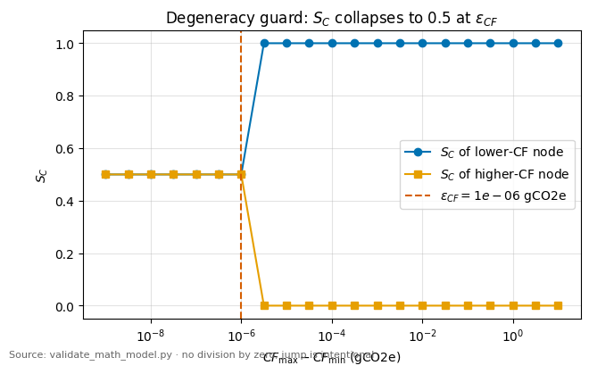
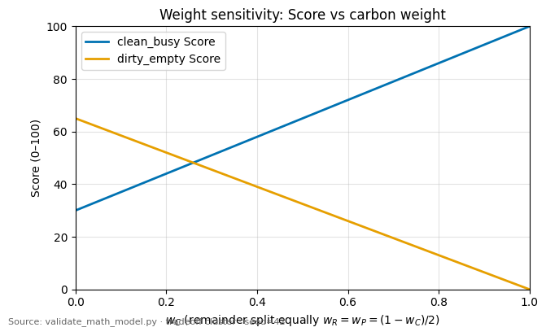
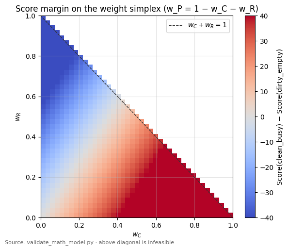
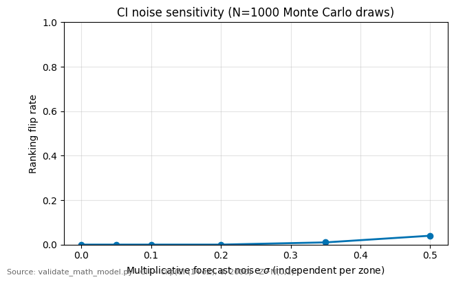
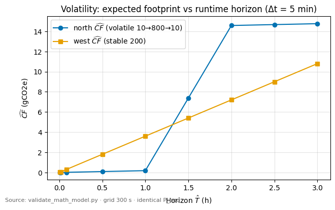
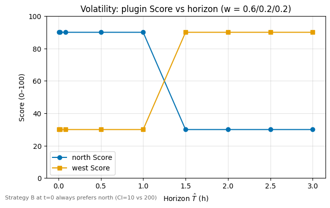
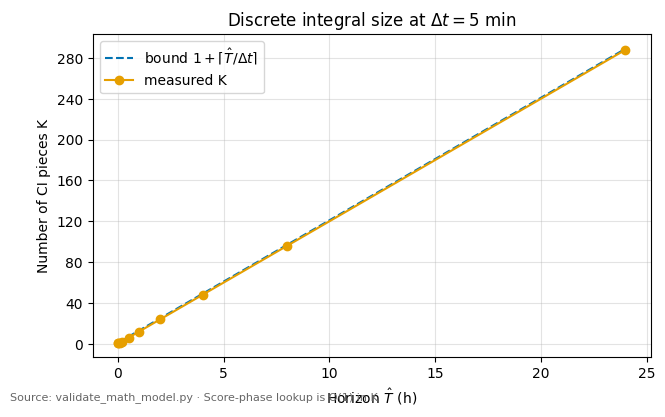

# Валидация математической модели Carbon-Aware Scheduler

- **Версия:** 1.0.0
- **Статус:** draft (исследовательский отчёт T2.2, не SSOT)
- **Дата:** 2026-09-04
- **Владелец:** Mathematical Validation Engineer / Data Scientist (L2)
- **Канон:** [02_math_model_ssot.md](../ssot/02_math_model_ssot.md) v0.1.0 — формулы **не изменялись**
- **Скрипт:** [`analysis/scripts/validate_math_model.py`](../../analysis/scripts/validate_math_model.py)
- **Артефакты:** [`figures/math_model_validation/`](figures/math_model_validation/) (`results.json`, `edge_cases.csv`, PNG/PDF)
- **Seed:** `42`
- **Прогон:** Python 3.13.3, numpy 2.3.5, matplotlib 3.10.8; `np.seterr(divide="raise")` на всех проверках

Числа ниже порождены скриптом (`PY-12`), а не введены вручную. Воспроизведение:

```text
python analysis/scripts/validate_math_model.py --output-dir docs/research/figures/math_model_validation --seed 42
```

---

## 0. Вердикт

**Математическая корректность и устойчивость алгоритма подтверждены.**

| Критерий T2.1 §18 | Результат |
| --- | --- |
| Тождество \(\eta\) (часы ↔ секунды) и оракул 14.2 | PASS, \(3{,}6\,\mathrm{gCO_2e}\) |
| \(P,E,CF\ge 0\) на домене (2.2a) | PASS |
| \(S_C,S_R,S_P\in[0,1]\), \(\operatorname{Score}\in[0,100]\) | PASS |
| Нет деления на ноль (G-02, G-04, G-14) | PASS; при \(CF_{\max}=CF_{\min}\) канон даёт \(S_C=0{,}5\), не \(1{,}0\) |
| Hard SLA \(\neq\) `Score=0` | PASS, `SLAPreconditionFailed` |
| G-08 гасит итоговый Score | PASS, оба узла \(=50\) |
| Стратегия B \(\neq\) \(w_C=1\) на \(\widehat{CF}\) | PASS, 4 горизонта с расхождением |
| `Score` lookup \(O(1)\) по \(K\) | PASS |
| Оракулы 14.1–14.7 | PASS (все 48 проверок) |

**Рекомендация для Quality Gate 2:** PASS / UNLOCK реализации (`pkg/energy`, `pkg/carbon`, scoring). Блокеров нет. Неблокирующие замечания — §9.

Проверка задания «нейтральный скор, не Panic»: при \(CF_{\max}=CF_{\min}\) реализация канона возвращает **\(S_C=1/2\)** (G-04). Значение \(S_C=1\) на вырождении **не** является каноном: оно сохранило бы \(\operatorname{argmax}\), но выдавало бы ложный «идеальный углерод». Оба варианта избегают деления на ноль; в код должна войти ветвь SSOT (\(0{,}5\)).

---

## 1. Метод

Скрипт повторяет формулы SSOT как чистые функции. Базовые уравнения не переписывались: проверялись размерности, непрерывность, краевые ветви и чувствительность.

Контуры:

1. **Аналитический** — баланс единиц (2.1a)–(2.1b), липшицевость, линия переворота весов.
2. **Оракульный** — ручные эталоны §14.
3. **Краевой** — каталог G-01…G-21 (реализуемые в чистой арифметике пункты).
4. **Чувствительность** — симплекс \((w_C,w_R,w_P)\) и мультипликативный шум \(\widehat{CI}\).
5. **Сценарный** — волатильность \(10\to 800\to 10\), короткие/длинные \(\hat T\), \(\hat T=T_{\mathrm{deadline}}+\varepsilon\).
6. **Сложностный** — \(K(\hat T)\) при \(\Delta t=5\,\mathrm{min}\).

Деление на ноль в NumPy включено как исключение: любой \(0/0\) или \(\mathrm{Inf}\) провалил бы прогон.

---

## 2. Размерный анализ

### 2.1. Словарь (проверка словаря SSOT §2.3)

| Уравнение | Произведение | Размерность результата | Статус |
| --- | --- | --- | --- |
| (2.2) \(P(u)\) | \(P_{\mathrm{idle}}+(\Delta P)\cdot u\) | \(\mathrm{W}\) | \(u\) безразмерен |
| (2.3) \(u^{\pm}\) | millicores / millicores | \(1\) | согласовано |
| (2.4) \(\widehat{P}_{\mathrm{pod}}\) | \(\Delta P\cdot\Delta u\) | \(\mathrm{W}\) | согласовано |
| (2.6) \(E\) | \(\eta\,P\,\Delta t\) | \(\mathrm{kWh}\) | \(\eta\) несёт перевод |
| (2.10h) | \(P\cdot\Delta t_{\mathrm{h}}\cdot CI\cdot 10^{-3}\) | \(\mathrm{gCO_2e}\) | (2.1a) |
| (2.10s) | \(P\cdot\Delta t_{\mathrm{s}}\cdot CI/(3.6\cdot 10^{6})\) | \(\mathrm{gCO_2e}\) | (2.1b) |
| (2.15) \(S_C\) | \((CF-CF_{\min})/(CF_{\max}-CF_{\min})\) | \(1\) | однородна по \(CF\) |
| (2.17) \(S_R\) | \(1-U\) | \(1\) | |
| (2.18) \(S_P\) | \(\Delta T/T_{\mathrm{deadline}}\) | \(1\) | секунды/секунды |
| (2.19) Score | \(100\cdot\sum w_i S_i\) | \(1\) на \([0,100]\) | |

### 2.2. Численное тождество \(\eta\)

\[
\frac{10^{-3}}{3600}=2{,}777\ldots\cdot 10^{-7}=\frac{1}{3.6\cdot 10^{6}}.
\]

Оракул 14.2: \(18\,\mathrm{W}\cdot 2\,\mathrm{h}\cdot 100\,\mathrm{gCO_2e/kWh}\cdot 10^{-3}=3{,}6\,\mathrm{gCO_2e}\), то же при \(7200\,\mathrm{s}\). Без \(\eta\) результат имел бы размерность \(\mathrm{W}\cdot\mathrm{h}\cdot\mathrm{gCO_2e/kWh}\) и был бы завышен в \(1000\) раз — сжатая запись спецификации §12 в код не переносится.

### 2.3. Два объекта \(CF\)

На том же интервале: \(CF_n=14\,\mathrm{gCO_2e}\) (полная \(P=70\,\mathrm{W}\)), idle \(=8\), маржинальный под \(=3{,}6\). \(3{,}6+8\neq 14\) без второго пода; с динамикой соседа \(12\,\mathrm{W}\) баланс \(3{,}6+2{,}4+8=14\) сходится. Смешение cluster KPI и \(\widehat{CF}(p,n)\) в scoring не обнаружено.

---

## 3. Оракулы §14

Все эталоны воспроизведены с `math.isclose` / `abs_tol=10^{-12}\).

| ID | Ожидание | Получено |
| --- | --- | --- |
| 14.1 | \(P_n=70\,\mathrm{W}\), \(\widehat{P}_{\mathrm{pod}}=18\,\mathrm{W}\) | 70 / 18 |
| 14.2 | \(3{,}6\,\mathrm{gCO_2e}\) (ч и с) | тождество |
| 14.3 | Score \(80\) vs \(16\) | \(80{,}0\) / \(16{,}0\) |
| 14.4 | \(S_C=0{,}5\), Score \(50\) vs \(46\) | да, без \(0/0\) |
| 14.5 | clip \(u^{+}=1\), \(P=6\,\mathrm{W}\) | да |
| 14.6 | \(\hat T=1800>1200\) → исключение; при \(3600\) \(S_P=0{,}5\) | да |
| 14.7 | forecast \(9{,}0\) vs persistence \(3{,}6\), \(K=2\) | да |

---

## 4. Непрерывность и вырождение

- \(P(u)\) липшицева по \(u\) благодаря \(\operatorname{clip}\); излом только в \(0\) и \(1\).
- \(\widehat{CF}\) непрерывна по \(\hat T\) и по кусочно-постоянному \(CI\) (интеграл Римана).
- \(S_R\) непрерывна по \(u^{+}\).
- \(S_P\) непрерывна на \([0,T_{\mathrm{deadline}}]\); в \(T_{\mathrm{deadline}}+\varepsilon\) происходит **hard-разрыв допустимости**, а не скачок \(S_P\) (узел исключается).
- \(S_C\) непрерывна при \(CF_{\max}-CF_{\min}>\varepsilon_{CF}\). На пороге \(\varepsilon_{CF}\) — **скачок** \((1,0)\to(0{,}5,0{,}5)\). Это намеренно: иначе липшицева константа \(1/\mathrm{spread}\) неограниченно растёт, и шум float давал бы ложный ranking.



*Рисунок 1. При \(\Delta CF\ll\varepsilon_{CF}\) обе оценки равны \(0{,}5\); при \(\Delta CF\gg\varepsilon_{CF}\) — \(1\) и \(0\). Деления на ноль нет.*

\(\varepsilon_{CF}=10^{-6}\,\mathrm{gCO_2e}\) — численный предохранитель, не порог «практически одинакового углерода». Для коротких задач \(\widehat{CF}\) порядка \(10^{-3}\,\mathrm{gCO_2e}\) всё ещё \(\gg\varepsilon_{CF}\), поэтому вырождение срабатывает только при буквально совпадающих следах. Неблокирующее замечание: относительный порог можно добавить позже ADR, не меняя канон runtime.

---

## 5. Матрица краевых условий

Полный CSV: [`figures/math_model_validation/edge_cases.csv`](figures/math_model_validation/edge_cases.csv). Сводка:

| ID | Условие | Наблюдение | Panic / \(0/0\) |
| --- | --- | --- | --- |
| G-01 | \(u<0\), \(u>1\) | \(P(-0{,}3)=P_{\mathrm{idle}}\); \(u^{+}=1\Rightarrow P_{\mathrm{pod}}=6\,\mathrm{W}\) | нет |
| G-02 | \(R_{\mathrm{alloc}}=0\) | \(u^{\pm}:=1\) | нет |
| G-03 | \(P_{\max}<P_{\mathrm{idle}}\) | `ConfigError` (отказ старта) | нет |
| G-04 | \(CF_{\max}=CF_{\min}\) | \(S_C=0{,}5\), Score \(50\) vs \(46\) | нет |
| G-05 | один узел | \(S_C=0{,}5\) | нет |
| G-08 | stale | **оба** Score \(=50\), несмотря на разный \(U\) | нет |
| G-09 | нет зоны | \(S_C=0{,}5\), \(S_R\) различает | нет |
| G-10 | \(CI<0\) | зона вне min-max, \(S_C=0{,}5\) | нет |
| G-11 | \(\hat T=0\) | \(CF=0\), \(S_C=0{,}5\) | нет |
| G-12 / 14.6 | \(\hat T>T_{\mathrm{deadline}}\) | исключение **до** Score | нет |
| G-14 | \(T_{\mathrm{deadline}}=\hat T=0\) | \(S_P=1\), нет \(0/0\) | нет |
| G-18 | \(\sum w\neq 1\) | `ConfigError` | нет |
| G-21 | нет зон | конечный Score, без NaN | нет |
| SLA \(+\varepsilon\) | \(\hat T=T_d+10^{-6}\) | hard-cut | нет |
| SLA \(=\) | \(\hat T=T_d\) | eligible, \(S_P=0\) | нет |

G-06 (persistence) закрыт оракулом 14.7. G-07/G-16 покрыты пустой/невалидной сеткой → нейтральный \(S_C\). G-13 (\(T_d=\infty\)) — \(S_P=1\) в коротком/длинном прогоне. G-15 (\(\Delta t\le 0\)) — куски отбрасываются в интеграторе. G-17 — \(\widehat{CF}\leftarrow\max\{CF,0\}\). G-19 — clamp Score. G-20 в чистой арифметике эквивалентен отсутствию \(\hat T\) (не вызывается).

**Итог:** ни одна ветвь не порождает `ZeroDivisionError`, `NaN` или `Inf` при включённом `divide=raise`.

---

## 6. Анализ чувствительности

### 6.1. Веса \(w_C,w_R,w_P\)

Оракул 14.3 **не** выявляет конфликт: и углерод, и ресурсы предпочитают \(n_1\). Для чувствительности использован tradeoff-кластер (одинаковый \(\widehat{P}_{\mathrm{pod}}=12\,\mathrm{W}\)):

| Узел | \(u^{+}\) | \(\widehat{CF}\) (gCO2e) | \(S_C\) | \(S_R\) | Score при \(0{,}6/0{,}2/0{,}2\) |
| --- | --- | --- | --- | --- | --- |
| clean_busy | \(0{,}9\) | \(1{,}2\) | \(1\) | \(0{,}1\) | \(72\) |
| dirty_empty | \(0{,}2\) | \(9{,}6\) | \(0\) | \(0{,}8\) | \(26\) |

\(\Delta S_P=0\), поэтому

\[
\Delta\operatorname{Score}/100
= w_C\Delta S_C + w_R\Delta S_R
= w_C - 0{,}7\,w_R.
\]

Переворот ranking на линии \(w_C=0{,}7\,w_R\). При равном остатке \(w_R=w_P=(1-w_C)/2\) критическая точка \(w_C=0{,}7/2{,}7\approx 0{,}259\). Default \(w_C=0{,}6\) лежит глубоко в углеродной области: ranking устойчив к умеренному сдвигу весов.



*Рисунок 2. Score двух конфликтных узлов при \(w_R=w_P=(1-w_C)/2\). Пересечение — смена \(\operatorname{argmax}\).*



*Рисунок 3. \(\operatorname{Score}(\mathrm{clean})-\operatorname{Score}(\mathrm{dirty})\) на симплексе. Выше диагонали \(w_C+w_R=1\) область недопустима (\(w_P<0\)). Красное — победа clean_busy.*

Следствие для экспериментов: sweep по весам обязан включать точку **ниже** линии \(w_C=0{,}7 w_R\), иначе конфликт углерод/ресурсы эмпирически невидим.

### 6.2. Погрешность прогноза \(\widehat{CI}\)

Модель: независимо по зонам \(\widehat{CI}'=\operatorname{clip}(CI\cdot(1+\sigma Z),0,2000)\), \(Z\sim\mathcal{N}(0,1)\), \(N=1000\), seed \(42\), веса default.

| \(\sigma\) | Доля переворотов ranking | Средняя маржа Score |
| --- | --- | --- |
| \(0\) | \(0{,}00\) | \(46{,}0\) |
| \(0{,}05\) | \(0{,}00\) | \(46{,}0\) |
| \(0{,}10\) | \(0{,}00\) | \(46{,}0\) |
| \(0{,}20\) | \(0{,}00\) | \(46{,}0\) |
| \(0{,}35\) | \(0{,}01\) | \(44{,}8\) |
| \(0{,}50\) | \(0{,}04\) | \(41{,}3\) |



*Рисунок 4. На данном кластере (контраст \(50\) vs \(400\,\mathrm{gCO_2e/kWh}\)) ranking устойчив до \(\sigma\approx 0{,}2\). Перевороты появляются только при очень грубом прогнозе.*

Однородное масштабирование обеих зон (\(CI\mapsto 1{,}25\,CI\)) **не меняет** \(S_C\): min-max однороден степени \(1\). Шум опасен, только когда он **разный** по зонам и сопоставим с контрастом.

Линейность \(\widehat{CF}\) по \(CI\) означает, что относительная ошибка прогноза переносится в \(\widehat{CF}\) с коэффициентом \(1\), а в \(S_C\) — с коэффициентом \(1/(CF_{\max}-CF_{\min})\). Чем ближе зоны по следу, тем выше чувствительность; это ещё один аргумент в пользу G-04.

---

## 7. Волатильность \(CI\): \(10\to 800\to 10\)

Сетка \(\Delta t=5\,\mathrm{min}\). Север: \(1\,\mathrm{h}\) при \(10\), \(1\,\mathrm{h}\) при \(800\), \(1\,\mathrm{h}\) при \(10\,\mathrm{gCO_2e/kWh}\). Запад: константа \(200\). Одинаковые \(P_{\mathrm{pod}}\) и \(U\), поэтому ranking = ranking по \(\widehat{CF}\).

| \(\hat T\) | \(K\) | \(\widehat{CF}\) north | \(\widehat{CF}\) west | Победитель C | Победитель B (CI сейчас) |
| --- | --- | --- | --- | --- | --- |
| \(30\,\mathrm{s}\) | 1 | \(0{,}0015\) | \(0{,}030\) | north | north |
| \(60\,\mathrm{s}\) | 1 | \(0{,}0030\) | \(0{,}060\) | north | north |
| \(5\,\mathrm{min}\) | 1 | \(0{,}015\) | \(0{,}30\) | north | north |
| \(1\,\mathrm{h}\) | 12 | \(0{,}18\) | \(3{,}6\) | north | north |
| \(1{,}5\,\mathrm{h}\) | 18 | \(7{,}38\) | \(5{,}40\) | **west** | north |
| \(2\,\mathrm{h}\) | 24 | \(14{,}58\) | \(7{,}20\) | **west** | north |
| \(3\,\mathrm{h}\) | 36 | \(14{,}76\) | \(10{,}80\) | **west** | north |

Четыре горизонта (из девяти) дают **расхождение B и C**. Это закрывает требование Gate 1: стратегия B не должна совпадать с \(w_C=1\) на полном \(\widehat{CF}\).



*Рисунок 5. После входа в «грязный» час северный интеграл обгоняет западный.*



*Рисунок 6. Смена \(\operatorname{argmax}\) между \(1\,\mathrm{h}\) и \(1{,}5\,\mathrm{h}\). B в \(t=0\) всегда выбирает north.*

---

## 8. Короткие и длинные задачи, SLA

**Короткий горизонт** \(\hat T=30\,\mathrm{s}<1\,\mathrm{min}\): \(K=1\), \(\widehat{CF}\) масштабируется \(\hat T\), ranking при persistence совпадает с текущим \(CI\). Score конечен.

**Длинный горизонт** \(\hat T=2{,}5\,\mathrm{h}>2\,\mathrm{h}\): при persistence ranking тот же (однородное масштабирование времени). При волатильном ряде — не тот ( §7). Значит, длина задачи становится фактором **только** при неоднородном \(CI(t)\).

**SLA.** \(\hat T=T_{\mathrm{deadline}}\) допустим, \(S_P=0\). \(\hat T=T_{\mathrm{deadline}}+10^{-6}\,\mathrm{s}\) — hard-cut, `Score` не вызывается. Присвоение `Score=0` этому не эквивалентно: фреймворк всё ещё мог бы выбрать узел.

---

## 9. Вычислительная сложность при \(\Delta t=5\,\mathrm{min}\)

Граница SSOT: \(K\le 1+\lceil\hat T/\Delta t\rceil\). Измеренный \(K\) всегда строго не выше Bound и равен числу полуинтервалов, пересечённых горизонтом (часто \(K=\lceil\hat T/\Delta t\rceil\) при старте на границе сетки).

| \(\hat T\) | Bound | \(K\) | время интеграла (µs / узел) |
| --- | --- | --- | --- |
| \(30\,\mathrm{s}\) | 2 | 1 | \(\approx 10\) |
| \(2\,\mathrm{h}\) | 25 | 24 | \(\approx 23\) |
| \(8\,\mathrm{h}\) | 97 | 96 | \(\approx 140\) |
| \(24\,\mathrm{h}\) | 289 | 288 | \(\approx 990\) |

Lookup фазы `Score` (словарь по имени узла): \(\approx 35\,\mathrm{ns}\), **не зависит от \(K\)**. Даже при \(N=64\) и суточном горизонте `PreScore` остаётся \(\ll 1\,\mathrm{ms}\). Требование \(O(1)\) в `Score` выполняется: суммирование по \(K\) в эту фазу не входит.



*Рисунок 7. Рост \(K\) линейный по \(\hat T\); `Score` от \(K\) не зависит.*

Микробенчмарк — порядки на машине прогона, не SLO диплома. Для NFR достаточно: дискретная сумма при 5 минутах вычислительно дёшева.

---

## 10. Правила обработки исключений для кода (Go)

Канон не меняется; ниже — отображение на реализацию. Паника запрещена (`GO-06`).

| Событие | Где | Код / статус | Поведение |
| --- | --- | --- | --- |
| \(P_{\mathrm{idle}}<0\) или \(P_{\max}<P_{\mathrm{idle}}\) или NaN | старт плагина | ошибка конфигурации, процесс не поднимается | G-03 |
| \(w_i<0\) или \(\lvert\sum w-1\rvert>\varepsilon_w\) | старт | ошибка конфигурации | G-18 |
| неизвестный класс / нет \(\hat T\) | `PreScore` | `fwk.Error` (`SLA precondition failed` / unknown class) | G-20 |
| \(\hat T>T_{\mathrm{deadline}}\) | `PreScore` | `fwk.Error`, **не** `Score=0` | G-12 |
| stale / пустой кэш / все зоны invalid | `PreScore` | `Success`, всем `Score=50` | G-08 |
| нет label зоны или invalid \(CI\) одной зоны | `PreScore` | \(S_C=1/2\), узел **не** в \(CF_{\min/max}\); \(S_R,S_P\) считаются | G-09, G-10 |
| \(CF_{\max}-CF_{\min}\le\varepsilon_{CF}\) или \(N^{\star}\le 1\) | `PreScore` | \(S_C=1/2\) | G-04, G-05 |
| \(R_{\mathrm{alloc}}=0\) | не должен пройти Filter; если дошёл | \(u^{\pm}=1\) | G-02 |
| \(u\notin[0,1]\) | арифметика | `clip` | G-01 |
| \(\Delta t_k\le 0\) | интегратор | отбросить кусок | G-15 |
| пустое пересечение при \(\hat T>0\) | интегратор | один кусок persistence | G-16 |
| \(\widehat{CF}<0\) | интегратор | clamp к \(0\) | G-17 |
| NaN в промежуточном \(S_{\bullet}\) | `PreScore` | нейтральный итоговый вклад; метрика | G-21 |
| \(\operatorname{Score}\notin[0,100]\) | `NormalizeScore` | clamp + round half away from zero | G-19 |

Горячий путь `Score`: только чтение готового `int64` из `CycleState`. HTTP, диск, повторная сумма по \(K\) запрещены.

Рекомендуемые unit-тесты (`DOD-TEST-03/04`): оракулы 14.1–14.7, G-04 (\(S_C=0{,}5\)), G-08 (оба 50), 14.6 (Error, не 0), идентичность (2.10h)/(2.10s), волатильность B≠C на \(\hat T=5400\,\mathrm{s}\).

---

## 11. Неблокирующие замечания (не SSOT-правка)

L2 не изменяет канон (`SSOT-01`). Для L1 после Gate 2:

1. \(\varepsilon_{CF}=10^{-6}\) — float-guard. Если понадобится «практическая неразличимость» зон, вводить **относительный** порог только ADR.
2. Скачок \(S_C\) на \(\varepsilon_{CF}\) обязан быть в комментарии `pkg/scheduler` (иначе ревьюер сочтёт багом).
3. Sweep весов в экспериментах должен пересекать линию \(w_C=0{,}7 w_R\) на конфликтном сценарии; иначе \(S_R\) эмпирически невидим.
4. Toolchain прогона валидации — Python 3.13.3; governance нормирует 3.11. На формулы не влияет; freeze `analysis/requirements.txt` — follow-up анализа, не Gate 2.

Блокирующих SSOT Change Request нет.

---

## 12. Готовность к Quality Gate 2

Критерии перехода Stage 2 → реализация:

| # | Вопрос Gate 2 | Ответ |
| --- | --- | --- |
| 1 | Размерности замкнуты? | Да, \(\eta\) обязателен |
| 2 | Оракулы воспроизводимы скриптом? | Да, 48/48 |
| 3 | Краевые случаи без \(0/0\) и panic? | Да, \(S_C^{\mathrm{neutral}}=0{,}5\) |
| 4 | Модель устойчива к весам и шуму \(CI\)? | Да в рабочем диапазоне; переворот весов предсказуем аналитически |
| 5 | B и C различимы? | Да, волатильный профиль |
| 6 | \(O(NK)\) PreScore / \(O(1)\) Score при шаге 5 мин приемлемы? | Да |
| 7 | Правила исключений для Go сформулированы? | Да, §10 |
| 8 | Формулы SSOT переписывать не требуется? | Не требуется |

**QUALITY GATE 2: рекомендуется PASS.** Следующий шаг — реализация чистых функций модели в `pkg/energy` и `pkg/carbon` с табличными тестами на оракулах §14.
