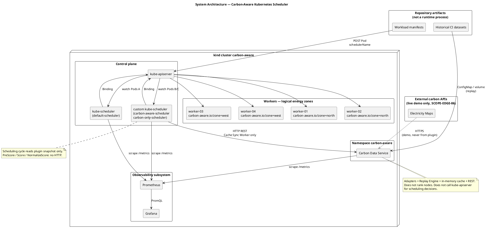
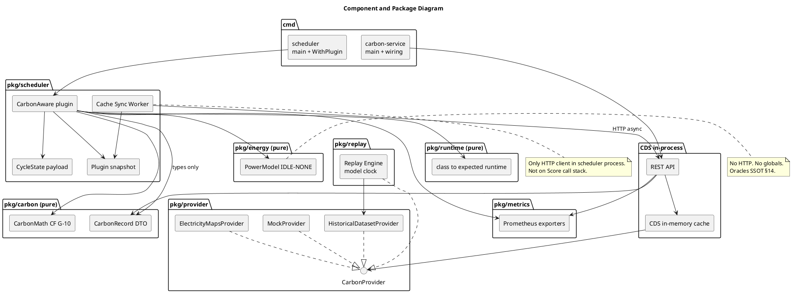
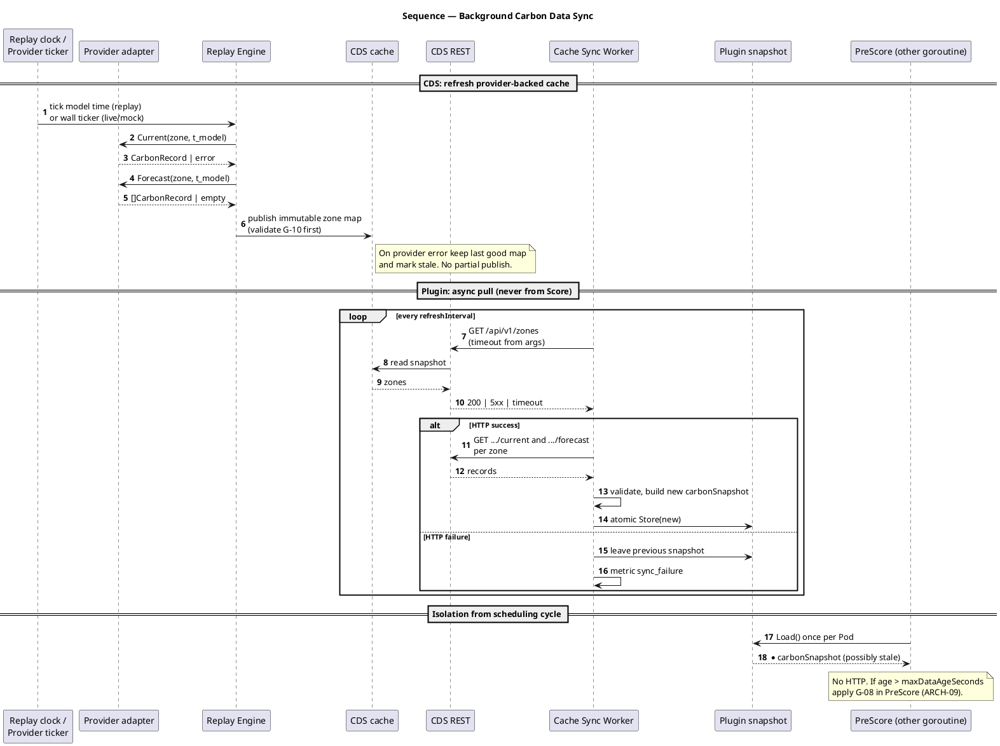
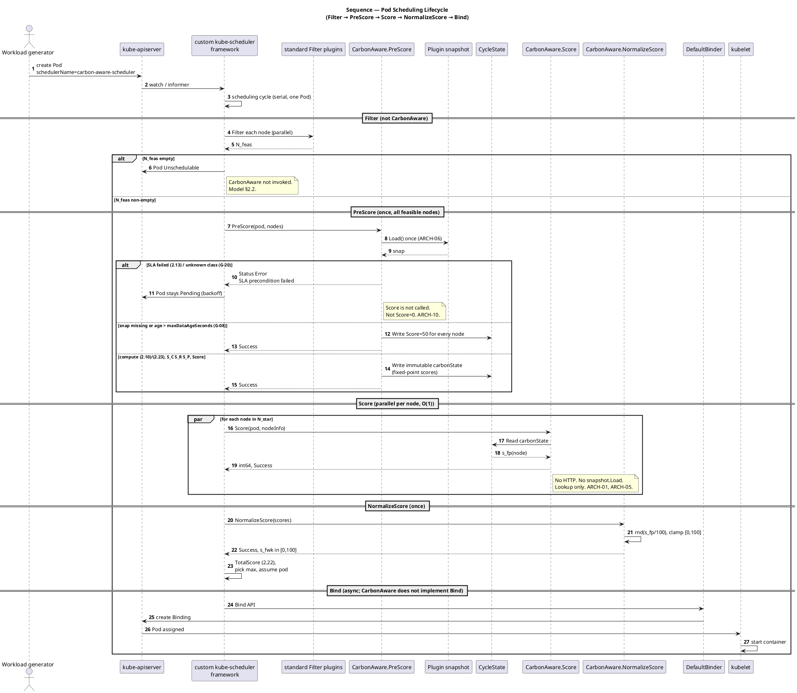

# Системная архитектура Carbon-Aware Kubernetes Scheduler

- **Версия:** 1.1.0
- **Статус:** accepted (LOCKED)
- **Дата утверждения:** 2026-09-04
- **Владелец:** Principal Distributed Systems Architect
- **Уровень изменяемости:** L1
- **Основание:** [governance.md](governance.md) (`SCOPE-IN-01`…`14`, `SCOPE-OUT-05`…`13`, `SCOPE-OUT-16`…`19`, `SCOPE-EDGE-02`…`06`, `DOD-CODE-12`, `GO-08`…`14`); [02_math_model_ssot.md](02_math_model_ssot.md) v1.0.0 LOCKED (ADR-001); [03_api_contracts_ssot.md](03_api_contracts_ssot.md) v1.0.1 LOCKED; [failure_and_fallback_policy.md](failure_and_fallback_policy.md) v1.1.0 LOCKED; [engineering-specification.md](engineering-specification.md) §§2–5, §33–40, §45–54, §60–69, §126; [scheduler_framework_analysis.md](../research/scheduler_framework_analysis.md) (T1.3); ADR [`002_system_architecture.md`](../decisions_adr/002_system_architecture.md); Freeze [`002_system_architecture_and_api_freeze.md`](../decisions_adr/002_system_architecture_and_api_freeze.md); Quality Gate 3
- **Следующие потребители:** Stage 4 (Carbon Data Service), Stage 5 (Scheduler Plugin); манифесты `deployments/*`

> **LOCKED / SSOT Freeze (Quality Gate 3).** Настоящий файл — единственный нормативный источник компонентной модели, границ процессов, потоков данных и точек расширения планировщика. Нормы `ARCH-*` **заблокированы**: агенты L2/L3 не вправе их менять без нового ADR (`SSOT-08`). Формулы (2.1)–(2.23) и предохранители G-01…G-21 **не дублируются и не уточняются**: при расхождении прав [02_math_model_ssot.md](02_math_model_ssot.md) (`CONF-03`, ADR-001). REST/DTO/annotations — [03_api_contracts_ssot.md](03_api_contracts_ssot.md). Автомат Fallback — [failure_and_fallback_policy.md](failure_and_fallback_policy.md). Имена метрик — [metrics.md](metrics.md).

Документ отвечает на вопрос: **какие процессы, пакеты и потоки данных реализуют заблокированную математическую модель, не нарушая запрет синхронного I/O в цикле планирования.**

---

## 0. Нормативные идентификаторы

| ID | Норма (сжато) |
| --- | --- |
| ARCH-01 | Горячий путь `PreScore` / `Score` / `NormalizeScore` не выполняет сетевых вызовов, обращений к диску и блокирующих ожиданий (`SCOPE-OUT-17`, `DOD-CODE-12`) |
| ARCH-02 | Углеродные данные попадают в плагин **только** через локальный in-memory снимок; связь с Carbon Data Service — **асинхронный pull** Cache Sync Worker |
| ARCH-03 | Carbon Data Service **не принимает решений** о размещении; Custom kube-scheduler **не ходит** во внешние Carbon API |
| ARCH-04 | Плагин реализует исключительно `PreScore` + `Score` + `NormalizeScore`. `Filter`, `QueueSort`, `Permit` запрещены; `Reserve` — только отдельным ADR (`SCOPE-OUT-16`) |
| ARCH-05 | `Score` — \(O(1)\) lookup готового значения из `CycleState`; арифметика \(O(NK)\) только в `PreScore` |
| ARCH-06 | Один `Load()` снимка на Pod в `PreScore`; все узлы цикла оцениваются по **одному** снимку \(CI\) |
| ARCH-07 | Углерод — критерий **предпочтения**, не допустимости: «грязная» зона не отсекается `Filter` |
| ARCH-08 | Изоляция стратегий — поле Pod `spec.schedulerName`; профиль `default-scheduler` **не** включает `CarbonAware` |
| ARCH-09 | Отказ источника \(CI\) не превращает работоспособный Pod в `Unschedulable`; срабатывает G-08 (нейтральный \(\operatorname{Score}=50\) всем узлам, `Success`) |
| ARCH-10 | Hard SLA (2.13) — `PreScore` `Error` (`SLA precondition failed`); это не temporal shifting и не `Score=0` |
| ARCH-11 | Наблюдаемость — pull Prometheus; планировщик **не** запрашивает Prometheus и не ходит в Metrics API в цикле планирования |
| ARCH-12 | Replay Engine использует **модельное** время сценария (`REPRO-03`); live Electricity Maps — только демонстрация (`SCOPE-EDGE-06`) |
| ARCH-13 | Нет Redis, Kafka, PostgreSQL, CRD-оператора, scheduler extender, service mesh (`SCOPE-OUT-05`…`13`) |
| ARCH-14 | Чистые функции модели живут в `pkg/energy`, `pkg/carbon`, `pkg/runtime`; I/O провайдеров — в `pkg/provider` / `pkg/replay` |
| ARCH-15 | Снимок плагина неизменяем после публикации; замена — атомарная смена указателя (предпочтительно `atomic.Pointer`; `sync.RWMutex` допустим по `GO-10`) |
| ARCH-16 | Opt-in: label `carbon-aware.io/enabled="true"` включает углеродный скоринг. Нет ключа или `"false"` → \(\operatorname{Score}=50\) всем, `Success`, `fallbackMode=opt_out`. Это **не** G-08 и не `fallback_total` (`API-META-02`) |

---

## 1. Назначение, объект и границы

### 1.1. Что делает система

Система при появлении нового Pod выбирает узел из множества, уже прошедшего **стандартный** Kubernetes `Filter`, минимизируя ожидаемый маржинальный углеродный след \(\widehat{CF}(p,n)\) на горизонте \(\hat T\) при соблюдении SLA и ресурсного предпочтения \(S_R\) — ровно постановка [02_math_model_ssot.md](02_math_model_ssot.md) §1.1.

Решение принимается **только при первичном размещении**. Уже запущенный Pod не перемещается (`SCOPE-OUT-01`, `SCOPE-OUT-14`).

### 1.2. Процессы runtime (обязательные)

| Процесс | Образ / бинарь | Экземпляров на стенде | Роль |
| --- | --- | --- | --- |
| Carbon Data Service | `cmd/carbon-service` → `carbon-data-service` | 1 (`SCOPE-OUT-19`) | Нормализация \(CI\), replay, кэш, REST |
| Custom kube-scheduler | `cmd/scheduler` → `carbon-aware-scheduler` | 1 | Плагин `CarbonAware` в профилях B/C |
| kube-scheduler (kind) | компонент control-plane | 1 | Профиль `default-scheduler` (стратегия A) |
| kube-apiserver, etcd, kubelet | kind node image | по топологии | стандартная плоскость |
| Prometheus | `deployments/prometheus` | 1 | scrape метрик |
| Grafana | `deployments/grafana` | 1 | дашборды |

Python (`analysis/`) **не** является runtime-процессом (`SCOPE-OUT-20`).

### 1.3. Что система сознательно не содержит

Не вводятся: live migration, multi-cluster federation, carbon-aware HPA, ML-прогноз \(CI\), брокер сообщений, внешняя СУБД, Redis, scheduler extender, собственный scheduler с нуля, Operator/CRD как обязательный механизм, rescheduling-контроллер, обращение к RAPL как к единственному источнику мощности, сеть/storage/embodied carbon в модели.

---

## 2. Ключевые архитектурные решения

### 2.1. Два процесса, два кэша, один горячий путь без сети

```text
Electricity Maps / Dataset / Mock
        │  (только CDS)
        ▼
┌───────────────────┐     REST      ┌──────────────────────────────┐
│ Carbon Data Svc   │◄──────────────│ Cache Sync Worker (plugin)   │
│  provider cache   │   async pull  │  goroutine, ticker + timeout │
└───────────────────┘               └──────────────┬───────────────┘
                                                   │ atomic store
                                                   ▼
                                    ┌──────────────────────────────┐
                                    │ Plugin snapshot (in-memory)  │
                                    └──────────────┬───────────────┘
                                                   │ Load() в PreScore
                                                   ▼
                                    PreScore → Score → NormalizeScore
                                    (нет HTTP, нет диска, нет Wait)
```

Планировщик **никогда** не вызывает Electricity Maps. Плагин **никогда** не вызывает REST CDS из `Score`. Единственный HTTP-клиент в процессе планировщика — Cache Sync Worker, живущий **вне** scheduling cycle.

Это закрывает пользовательское ограничение Stage 3 и `SCOPE-OUT-17` одновременно.

### 2.2. Почему не Extender и не синхронный вызов в `Score`

Scheduler Extender — синхронный HTTP webhook на каждую попытку (`SCOPE-OUT-08`). Таймаут внешнего API стал бы таймаутом планирования всего кластера. In-tree plugin с предзагруженным снимком даёт предсказуемую задержку и воспроизводимый срез \(CI\) на все узлы одного Pod (`ARCH-06`, `REPRO-17`).

### 2.3. Почему Carbon Data Service не встраивается в бинарь планировщика

CDS должен уметь replay модельного времени, смену провайдера и отдачу REST для Prometheus/демонстрации **независимо** от цикла планирования. Сбой или медленный провайдер старит кэш CDS, но не блокирует `Score`. Процессы разделяют только канонический DTO `pkg/carbon` (без I/O) и HTTP-контракт (T3.2).

### 2.4. Почему углерод не в `Filter`

Узел в зоне с высокой \(CI\) остаётся работоспособным. Отсев на `Filter` при «грязных» данных во всех зонах остановил бы планирование — нарушение `SCOPE-IN-09` и `ARCH-07`. Стратегии A и C обязаны иметь **одно и то же** множество \(\mathcal{N}_{\mathrm{feas}}\); иначе эксперимент сравнивает разные допустимые множества, а не алгоритмы ранжирования.

---

## 3. Поток данных (границы контуров)

Два независимых контура. Стрелка «использует» из scheduling cycle в CDS **запрещена**.

| Контур | Триггер | I/O | Писатель состояния | Читатель |
| --- | --- | --- | --- | --- |
| **A. Обновление углерода** | ticker CDS; ticker Cache Sync Worker; шаг модельного времени replay | HTTP наружу (только CDS, demo); чтение датасета (только CDS); HTTP CDS←Worker | кэш CDS; snapshot плагина | REST CDS; Worker |
| **B. Планирование Pod** | watch apiserver | только API Kubernetes (Filter/Bind/assume) | `CycleState` (на попытку) | `PreScore` пишет, `Score`/`NormalizeScore` читают |
| **C. Наблюдаемость** | scrape Prometheus | HTTP `/metrics` | экспортёры | Prometheus, Grafana |
| **D. Ex-post KPI** | после прогона | Prometheus TSDB, логи Binding | анализ Python | диплом / графики |

Контур D **не** питает `Score`. Утилизация для \(u_n^{\pm}\) берётся из снимка планировщика (`NodeInfo.GetRequested()` / allocatable), не из cAdvisor (`ARCH-11`).

Состояние одного Pod на все узлы — **один** snapshot \(CI\) (`02_math_model_ssot.md` §15).

---

## 4. System Architecture Diagram



**Инварианты диаграммы.** (1) Единственная стрелка `custom kube-scheduler → CDS` подписана Cache Sync Worker. (2) `Electricity Maps` не имеет ребра к планировщику. (3) Prometheus не имеет ребра **к** планировщику (только scrape **от** него). (4) Worker-узлы получают Pod через Binding apiserver, не от плагина напрямую.

---

## 5. Подсистема: Carbon Data Service

Отдельный процесс (`SCOPE-IN-02`). Задача — **подготовить достоверное состояние \(CI\)**, а не выбрать узел (`ARCH-03`).

Точка входа: `cmd/carbon-service`. Порт HTTP стенда: **8080** (REST + `/metrics` на том же listener). HA, реплики, autoscaling сервиса запрещены (`SCOPE-OUT-19`).

### 5.1. Адаптеры провайдеров

Интерфейс объявляется на стороне потребителя (`GO-16`): CDS требует узкий `CarbonProvider`.

| Реализация | Когда используется | I/O | Зачётные числа диплома |
| --- | --- | --- | --- |
| `MockProvider` | unit/integration, синтетика | нет внешней сети | допустимы как фикстуры тестов, не как глава с KPI |
| `HistoricalDatasetProvider` | через Replay Engine | чтение локального датасета | **да** (`REPRO-01`) |
| `ElectricityMapsProvider` | live demo | HTTPS + Secret с ключом | **нет** (`SCOPE-EDGE-06`) |

Адаптер обязан вернуть канонический `CarbonRecord` (единица `gCO2e/kWh`, average consumption-based lifecycle) либо ошибку. Смешение direct и lifecycle в одном ответе запрещено (модель §6.5). Парсинг внешних JSON и маппинг зон — ответственность адаптера, не плагина.

Пакет: `pkg/provider`. Провайдеры **не** импортируют `pkg/scheduler`.

### 5.2. Replay Engine

Пакет: `pkg/replay`. Воспроизводит ряд \(CI(z,t)\) по **модельному** времени сценария, не по wall-clock (`ARCH-12`, `REPRO-03`).

Обязанности:

1. Загрузить версионированный датасет (`experiments/datasets/`, `VER-20`) и проверить схему.
2. Держать `t_{\mathrm{model}}\) (инжектируемые часы, `DOD-TEST-01`).
3. На запрос `current` вернуть кусок сетки, содержащий \(t_{\mathrm{model}}\).
4. На запрос `forecast` вернуть последующие куски горизонта **из того же файла**, если они помечены как forecast; иначе пустой forecast → persistence (2.11) выполняется **в плагине**, не подменой будущих actual (`perfect foresight` в зачётном прогоне запрещён, модель §6.5).
5. Продвигать \(t_{\mathrm{model}}\) командой сценария / тиком replay, а не `time.Now()`.

Replay Engine для CDS выглядит как ещё один `CarbonProvider`. Плагин не знает, replay это или mock: он видит REST.

### 5.3. In-Memory Cache (CDS)

Кэш **внутрипроцессный** (`SCOPE-OUT-10`). Ключ — идентификатор зоны. Значение — нормализованные current + forecast + метаданные качества.

Обязанности:

- запись только после валидации: \(CI \in [0, 2000]\,\mathrm{gCO_2e}/\mathrm{kWh}\), не NaN, не \(\pm\infty\) (G-10);
- хранение `timestamp`, `source`, `quality`, `expiresAt` / возраста;
- freshness для `/api/v1/health` и заголовков/полей ответа;
- при ошибке провайдера **сохранять последний валидный снимок** и помечать его stale; не отдавать частично обновлённую карту зон (сборка нового map + атомарная замена, как у плагина).

Конкурентный доступ: `sync.RWMutex` или атомарная замена снимка (`GO-10`). Нет persistence на диск как на обязательный путь (после рестарта CDS кэш холодный; Worker увидит промах и либо получит данные после прогрева, либо состарит свой snapshot → G-08).

### 5.4. REST API

Единственный runtime-контракт CDS ↔ плагин. Нормативные пути (`SCOPE-IN-02`):

| Метод | Путь | Назначение |
| --- | --- | --- |
| GET | `/api/v1/zones` | список известных зон |
| GET | `/api/v1/zones/{zone}/current` | текущий `CarbonRecord` |
| GET | `/api/v1/zones/{zone}/forecast` | ряд прогноза на горизонт |
| GET | `/api/v1/health` | liveness/readiness + freshness (`SCOPE-IN-02`) |
| GET | `/api/v1/healthz` | **тот же обработчик**, путь probes Kubernetes |
| GET | `/metrics` | Prometheus exposition |

JSON-схемы, коды ошибок и заголовки фиксирует [03_api_contracts_ssot.md](03_api_contracts_ssot.md) (LOCKED). Архитектурные правила контракта:

- единица измерения в поле ответа обязательна (`DOD-DOC-05`);
- отсутствующая зона → 404; плагин трактует как G-09 для узлов этой зоны, не как падение планировщика;
- CDS не предоставляет endpoint «посчитать Score» или «выбрать node»;
- все обработчики имеют явный `context.Context` timeout (`GO-08`, `GO-09`).

Аутентификация на стенде: ClusterIP Service, NetworkPolicy «только из namespace планировщика». Ключ Electricity Maps — Secret, не ConfigMap (`DOD-CODE-07`).

### 5.5. Чего CDS не делает

Не watch Pod/Node для скоринга. Не вызывает Binding API. Не считает \(P(u)\), \(\widehat{CF}\), \(S_C\). Не хранит историю в PostgreSQL: исторический ряд — файлы датасета; оперативные ряды эксперимента — Prometheus.

---

## 6. Подсистема: Custom kube-scheduler

Бинарь `cmd/scheduler`: `app.NewSchedulerCommand(app.WithPlugin("CarbonAware", carbonaware.New))`. Это **kube-scheduler с одним дополнительным плагином**, не собственный планировщик (`SCOPE-OUT-07`).

Развёртывание на стенде: **второй** Deployment/Pod (`carbon-aware-scheduler`) рядом с kind `kube-scheduler`. Leader election у второго планировщика выключен (`--leader-elect=false`): один экземпляр (`SCOPE-OUT-19`). Версия Kubernetes зависимости бинаря должна совпадать с patch-линией kind node image (1.37.x; точный patch — инфраструктурный ADR до зачётного прогона).

### 6.1. Плагин `CarbonAware`

Имя в реестре и в `KubeSchedulerConfiguration`: `CarbonAware`.

Compile-time контракт (обязателен в коде T4.x):

- реализует `fwk.Plugin`, `fwk.PreScorePlugin`, `fwk.ScorePlugin`, `fwk.ScoreExtensions`;
- **не** реализует `FilterPlugin`, `PermitPlugin`, `QueueSortPlugin`; `ReservePlugin` — только после ADR.

Фабрика `New(ctx, args, handle)`:

1. Декодирует `pluginConfig.args` (`GO-12`, `REPRO-06`): \(w_C,w_R,w_P\), \(\lambda\), \(P_{\mathrm{idle}},P_{\mathrm{max}}\) (или имя профиля мощности), таблица классов runtime, `maxDataAgeSeconds`, URL CDS, `refreshInterval`, `httpTimeout`, `scoringMode`.
2. Проверяет домен (2.2a) и (2.20); при нарушении **не стартует** (G-03, G-18) — fail-closed по конфигу.
3. Запускает Cache Sync Worker в goroutine, отмена по `ctx` фабрики (у плагина нет `Start()`).
4. Не хранит `context.Context` в структуре плагина (`GO-08`).

`fwk.Handle.SnapshotSharedLister()` **вне** scheduling cycle не используется. Список узлов для скоринга — аргумент `PreScore`, не повторный List информера.

### 6.2. Cache Sync Worker

Единственный сетевой клиент процесса планировщика к CDS (`ARCH-02`).

Алгоритм (нормативный, без magics в коде — интервалы из args):

1. Тик `refreshInterval` (канон конфигурации стенда: \(30\,\mathrm{s}\); должно быть \(\ll\) `maxDataAgeSeconds`, канон \(300\,\mathrm{s}\)).
2. `GET /api/v1/zones`, затем current и forecast по каждой зоне. HTTP client timeout из args (`GO-09`), например \(2\,\mathrm{s}\).
3. Валидация записей (G-10). Сборка **нового** неизменяемого `carbonSnapshot` (карта зоны → ряд \(CI\), `fetchedAt`, флаги качества).
4. Атомарная публикация снимка. Старый снимок становится недостижим и собирается GC.
5. При ошибке сети/5xx: **не** затирать последний хороший снимок; инкремент метрики sync failure; снимок стареет по `fetchedAt` до G-08.

Worker **не** вызывается из `PreScore`/`Score`. Нет `Wait` на канал «кэш готов» в горячем пути: пустой снимок обрабатывается как G-07 → G-10/G-08.

Обнаружение зон: REST `/zones` ∪ (опционально) уникальные значения label узлов из SharedInformer **в Worker**, не в `Score`. Новая зона появляется в следующем тике (`engineering-specification.md` §66).

### 6.3. Локальный in-memory снимок плагина

Это **второй** кэш, отдельный от кэша CDS. Без него `Score` вынужден был бы ходить в сеть.

Инвариант: структура immutable после `Store`. Горячий путь делает один `Load` в `PreScore` (`ARCH-06`). Даже если Worker опубликует новый снимок посреди параллельного `Score`, текущий Pod продолжает считать по старому указателю, уже скопированному в локальную переменную / `CycleState`.

Возраст для G-08: \(\mathrm{age}=t_{\mathrm{now}}-t_{\mathrm{fetchedAt}}\) по часам планировщика (инжектируемым в тестах). В replay CDS отдаёт запись, согласованную с \(t_{\mathrm{model}}\); Worker при успешном тике обновляет `fetchedAt`, поэтому G-08 срабатывает при **обрыве sync**, а не при «старом» значении сетки внутри датасета.

### 6.4. `PreScore`

Один вызов на Pod, все \(n \in \mathcal{N}_{\mathrm{feas}}\) разом (Kubernetes 1.37: `nodes []fwk.NodeInfo`).

Нормативный порядок (согласован с [03_api_contracts_ssot.md](03_api_contracts_ssot.md) §6 и [failure_and_fallback_policy.md](failure_and_fallback_policy.md) §7.2):

1. Разобрать labels/annotations Pod → `WorkloadProfile` (ключи `carbon-aware.io/*`, канон API §6). Невалидное значение `enabled` или ключ на чужой поверхности — `Status(Error, "SLA precondition failed")` (конфиг workload).
2. Opt-in (`ARCH-16`): если `enabled≠true` — записать **всем** узлам \(\operatorname{Score}_{\mathrm{neutral}}=50\), `fallbackMode=opt_out`, `Success`. Не инкрементировать `fallback_total`. G-20 / hard SLA **не** применяются (горизонт для углеродного скоринга не нужен). HTTP и `snapshot.Load()` не требуются.
3. Иначе разрешить \(\hat T\): явный `expected-duration`, иначе таблица класса, иначе `defaultWorkloadClass`. Если \(\hat T\) не определён — G-20, `Status(Error, "SLA precondition failed")`.
4. Hard SLA (2.13): если \(\hat T > T_{\mathrm{deadline}}\) — `Status(Error, "SLA precondition failed")`. `Score` не вызывается. Pod остаётся `Pending`, стандартный backoff (`ARCH-10`, G-12). Это **не** G-08 и не `Score=0`.
5. `snap := snapshot.Load()` ровно один раз (`ARCH-06`).
6. Если снимок nil / пуст / \(\mathrm{age}>\texttt{maxDataAgeSeconds}\) / все зоны invalid — записать **всем** узлам \(\operatorname{Score}_{\mathrm{neutral}}=50\), `Success`, метрика fallback (G-08). Не нейтрализовать только \(S_C\).
7. Иначе для каждого узла: зона из `carbon-aware.io/zone`; \(u^{\pm}\), \(\widehat{P}_{\mathrm{pod}}\), разбиение горизонта, \(\widehat{CF}\) (2.10s) или (2.23); G-09/G-10 по узлу.
8. \(CF_{\min}, CF_{\max}\) по \(\mathcal{N}^{\star}\) **без** узлов G-09; \(S_C,S_R,S_P\); (2.19); fixed-point \(s^{\mathrm{fp}}=\operatorname{rnd}(100\cdot\operatorname{Score})\in\{0,\ldots,10000\}\) (модель §9.2).
9. `state.Write(carbonStateKey, immutable carbonState)`.
10. Метрики длительности и (гипотеза эксперимента) гистограммы \(\widehat{CF}\) кандидатов — здесь, не в `Score`.

Режим `scoringMode: current-ci` (стратегия B): вместо (2.10) считается (2.23); \(w_C=1\), \(w_R=w_P=0\). Это **не** (2.19) с \(w_C=1\) на \(\widehat{CF}\).

Паника запрещена (`GO-06`). NaN промежуточных \(S_{\bullet}\) → G-21.

### 6.5. `Score`

Сигнатура 1.37: `(int64, *Status)` по одному `NodeInfo`. Параллельно по узлам (до `parallelism` фреймворка).

Норма: прочитать `carbonState`, вернуть `scorePerNode[nodeName]`. Нет аллокаций карт, нет I/O, нет обращения к snapshot Worker (снимок уже зафиксирован в `CycleState`). Отсутствие ключа — дефект `PreScore`; безопасный ответ: нейтраль + `Success`, не `Error` (ошибка данных/состояния не должна отменять Pod, кроме hard SLA / G-20 в `PreScore`).

Сложность \(O(1)\) (`ARCH-05`).

### 6.6. `NormalizeScore`

Вход — только `NodeScoreList` (имя → int64). Физические величины недоступны — поэтому min-max \(S_C\) **нельзя** переносить сюда.

Норма: \(s_{\mathrm{fwk}}=\operatorname{clamp}(\operatorname{rnd}(s^{\mathrm{fp}}/100),0,100)\) (2.21). Страховка контракта фреймворка: значение вне \([0,100]\) после этой фазы даёт `Error` и срывает цикл.

После `NormalizeScore` фреймворк считает \(\operatorname{TotalScore}\) (2.22). Путать \(w_C\) с \(w_{\mathrm{CA}}^{\mathrm{fw}}\) запрещено.

### 6.7. Bind и метрики решения

`CarbonAware` **не** реализует `Bind`. Привязку выполняет стандартный `DefaultBinder` в binding cycle (отдельная goroutine). Плагин не держит ссылку на `CycleState` после цикла (`GO-08` по духу; KEP-624: состояние невалидно после attempt).

Выбранный узел для анализа эксперимента восстанавливается из Binding / kube-state-metrics и сопоставляется с логом/метриками кандидатов из `PreScore`. Отдельный `PostBind` не вводится в Scope.

### 6.8. Пакеты планировщика

| Пакет | Содержимое | I/O |
| --- | --- | --- |
| `pkg/scheduler` | plugin, PreScore/Score/Normalize, Worker, snapshot, CycleState DTO | HTTP **только** в Worker |
| `pkg/energy` | (2.2)–(2.4), clip | нет (`GO-13`) |
| `pkg/carbon` | (2.7)–(2.11), G-10 как чистые предикаты, DTO Record | нет |
| `pkg/runtime` | (2.12) таблица класс → \(\hat T\) | нет |
| `pkg/metrics` | регистрация Prometheus | экспорт `/metrics` через процесс |

Запрет: `pkg/energy|carbon|runtime` → `pkg/scheduler` или `cmd/*` (`GO-19`).

---

## 7. Подсистема: Observability

`SCOPE-IN-12`. Контур **C** в §3. Имена метрик канонизированы в [metrics.md](metrics.md) (LOCKED, Quality Gate 3); архитектура фиксирует **топологию съема**. Scrape-конфиги и Grafana JSON — манифесты `deployments/*` (реализация Stage 4+).

### 7.1. Prometheus Exporters

| Источник | Что отдаёт | Кто scrape | Используется в `Score` |
| --- | --- | --- | --- |
| CDS `/metrics` | возраст данных, ошибки провайдера, режим replay/live, число зон | Prometheus | нет |
| custom scheduler `/metrics` | стандартные метрики kube-scheduler + `carbon_aware_*` | Prometheus | нет |
| kind kube-scheduler `/metrics` | baseline A latency | Prometheus | нет |
| kubelet / cAdvisor / kube-state-metrics | CPU/RAM **ex-post**, Binding, фазы Pod | Prometheus | нет |

Плагин регистрирует как минимум (имена — [metrics.md](metrics.md), смысл обязателен):

- решения / попытки скоринга;
- `fallback_total` (G-08 и пустой кэш);
- `sla_rejection_total` (отдельно от fallback);
- возраст снимка, секунды;
- длительность Worker sync и ошибки HTTP;
- длительность `PreScore` (собственная; плюс `scheduler_framework_extension_point_duration_seconds`).

Ловушка Kubernetes: `scheduler_plugin_execution_duration_seconds` семплируется (~10 %). Эксперимент overhead (`SCOPE-IN-14`) обязан опираться на **несэмплируемую** `scheduler_framework_extension_point_duration_seconds` (T1.3 §9.3).

### 7.2. Grafana

Дашборды в `deployments/grafana/`. Минимум панелей (гипотеза набора; JSON дашборда — реализация, не формула):

- \(CI(t)\) по зонам (из CDS);
- возраст данных и rate fallback;
- scheduling latency A vs B vs C;
- выбранные узлы / зоны;
- ex-post cluster \(CF\) (считается **офлайн** формулами (2.9), не в плагине).

Grafana не является управляющим контуром.

### 7.3. Запреты наблюдаемости

Планировщик не делает PromQL. CDS не пишет в Grafana API. Отсутствие Prometheus не останавливает scheduling (`engineering-specification.md` §62): экспорт метрик best-effort, ошибки экспорта не влияют на `Status` плагина.

---

## 8. Подсистема: Experimental Multi-Zone Cluster Environment

`SCOPE-IN-11`. Кластер kind имя `carbon-aware`, манифест `deployments/kind/cluster.yaml`: 1 control-plane + ≥ 4 worker.

### 8.1. Логические энергозоны

Физически узлы — контейнеры одной лабораторной машины. География **моделируется** label:

```yaml
metadata:
  labels:
    carbon-aware.io/zone: north   # или west, ...
    carbon-aware.io/power-profile: standard
```

Канон стенда по умолчанию (спецификация §46):

| Узел | Зона | Назначение |
| --- | --- | --- |
| worker-01 | `north` | низкая \(CI\) в типичном датасете |
| worker-02 | `north` | тот же \(CI\), другой ресурсный снимок |
| worker-03 | `west` | высокая \(CI\) |
| worker-04 | `west` | высокая \(CI\) |

Два узла на зону отделяют эффект \(CI\) от эффекта \(S_R\). Иные раскладки — только в карточке сценария (`REPRO-12`: сравниваемые стратегии на идентичной топологии).

Узел без зоны **не** исключается (G-09, `SCOPE-EDGE-02`).

### 8.2. Ресурсы и мощность

\(P_{\mathrm{idle}}, P_{\max}\) — конфигурация сценария, не показание RAPL kind-node (`SCOPE-OUT-15`, LIM-01). Калибровка CAL-A/B/C — вне цикла планирования.

Узлы считаются всегда включёнными (инвариант модели §12): нет power-off controller.

### 8.3. Нагрузка

Поды создаются из `experiments/workloads/`, не руками (`REPRO-05`). Поле `spec.schedulerName` выбирает профиль (§10). Opt-in углерода — labels/annotations `carbon-aware.io/*` (`SCOPE-IN-10`). CRD не требуется (`SCOPE-OUT-12`).

### 8.4. Сеть стенда

NetworkPolicy (рекомендуется, не service mesh):

- scheduler SA → CDS :8080;
- Prometheus → CDS :8080 и scheduler metrics port;
- CDS → egress HTTPS только в live demo;
- запрет Worker → Electricity Maps;
- запрет scheduler → Internet.

---

## 9. Component & Package Diagram



**Граница ответственности.** Стрелка `CarbonAware plugin → REST API` **отсутствует**. Есть только `Cache Sync Worker → REST API`. Чистые пакеты не зависят от `pkg/provider`.

Раскладка файлов внутри пакетов — дело реализации, не SSOT; имена пакетов — норма `GO-03`/`ARCH-14`. Уточнение относительно инженерной спецификации §70 (`CONF-05`): `provider.go` / `replay.go` / `cache.go` **не** смешиваются с формулами в `pkg/carbon`, чтобы I/O не просочился в unit-тесты модели.

---

## 10. Sequence Diagram: Background Carbon Data Sync

Контур A. Scheduling cycle на этой диаграмме **не** является вызывающим REST.



**Проверка асинхронности.** На диаграмме нет сообщения `PreScore → REST` и нет `Score → *`. Единственный потребитель REST в планировщике — Worker. `PreScore` читает память.

---

## 11. Sequence Diagram: Pod Scheduling Lifecycle

Контур B. CDS на диаграмме отсутствует сознательно: к моменту `PreScore` данные уже в snapshot.



**Согласованность с моделью.** `Filter` → \(\mathcal{N}_{\mathrm{feas}}\); SLA в `PreScore` → \(\mathcal{N}_{\mathrm{SLA}}\); G-08 гасит итоговый Score целиком; `Score` не интегрирует по \(K\); Bind не пересчитывает углерод.

---

## 12. Модель изоляции профилей планировщика

### 12.1. Зачем два имени, а не замена default

Сравнение A/B/C должно идти **в одном кластере, на тех же узлах и том же ряде \(CI\)** (`engineering-specification.md` §49–50, `REPRO-12`). Различающий фактор — алгоритм ранжирования, а не топология.

Механизм Kubernetes: `spec.schedulerName`. Планировщик обрабатывает только Pod, чьё имя совпало с `schedulerName` профиля.

### 12.2. Процессы и профили

| Стратегия (`SCOPE-IN-13`) | `schedulerName` | Процесс | `CarbonAware` | Прочие Score-плагины | Внутренние веса | `scoringMode` |
| --- | --- | --- | --- | --- | --- | --- |
| A — baseline | `default-scheduler` (или пусто) | kind `kube-scheduler` | **нет** | стандарт 1.37 | н/п | н/п |
| B — carbon-only | `carbon-only-scheduler` | custom `kube-scheduler` | **да** | Score/PreScore default **выключены** (`disabled: '*'`) | \(w_C=1,w_R=w_P=0\) | `current-ci` (2.23) |
| C — proposed | `carbon-aware-scheduler` | custom `kube-scheduler` | **да** | стандарт 1.37 сохранены | default \((0{,}6,0{,}2,0{,}2)\) или sweep | `expected-cf` (2.19) |

Изоляция A vs C — **два процесса** с непересекающимися `schedulerName`. Custom-бинарь **не** объявляет профиль `default-scheduler`, чтобы не конкурировать за лидерство и не смешивать очереди с kind scheduler (`ARCH-08`).

Стратегия B вынесена в третий профиль того же custom-бинаря: иначе B и C делили бы очередь и `pluginConfig`. Это уточнение относительно «двух профилей» спецификации §49 (`CONF-05`); две пользовательские оси изоляции (`default-scheduler` vs `carbon-aware-scheduler`) сохраняются, B добавляется как экспериментальный профиль того же бинаря.

### 12.3. Почему B нельзя включить через `multiPoint` + `score.disabled: ['*']`

В Kubernetes 1.37 `disabled: '*'` на точке расширения обрывает развёртку `multiPoint` **до** включения явно перечисленного в `multiPoint` плагина (T1.3 §7.5). `CarbonAware` исчез бы из `Score`, планировщик стартовал бы, а стратегия B стала бы неотличима от случайного выбора.

Норма: для профиля B регистрировать `CarbonAware` **явно** в `preScore` и `score`, и только там ставить `disabled: '*'`. `Filter` остаётся стандартным (`SCOPE-IN-08`).

### 12.4. Нормативные фрагменты `KubeSchedulerConfiguration`

Custom-бинарь (профили B и C в одном файле):

```yaml
apiVersion: kubescheduler.config.k8s.io/v1
kind: KubeSchedulerConfiguration
profiles:
  - schedulerName: carbon-aware-scheduler
    plugins:
      multiPoint:
        enabled:
          - name: CarbonAware
            weight: 13   # w_CA^fw; параметр карточки эксперимента, не w_C
    pluginConfig:
      - name: CarbonAware
        args:
          scoringMode: expected-cf
          carbonWeight: 0.6
          resourceWeight: 0.2
          performanceWeight: 0.2
          lambda: 1
          powerIdleWatts: 40
          powerMaxWatts: 100
          maxDataAgeSeconds: 300
          staleWarnSeconds: 90
          clockSkewSeconds: 60
          refreshIntervalSeconds: 30
          httpTimeoutSeconds: 2
          carbonServiceURL: http://carbon-data-service.carbon-aware.svc:8080
  - schedulerName: carbon-only-scheduler
    plugins:
      preScore:
        enabled:
          - name: CarbonAware
        disabled:
          - name: "*"
      score:
        enabled:
          - name: CarbonAware
            weight: 1
        disabled:
          - name: "*"
    pluginConfig:
      - name: CarbonAware
        args:
          scoringMode: current-ci
          carbonWeight: 1.0
          resourceWeight: 0.0
          performanceWeight: 0.0
          lambda: 1
          powerIdleWatts: 40
          powerMaxWatts: 100
          maxDataAgeSeconds: 300
          staleWarnSeconds: 90
          clockSkewSeconds: 60
          refreshIntervalSeconds: 30
          httpTimeoutSeconds: 2
          carbonServiceURL: http://carbon-data-service.carbon-aware.svc:8080
```

Kind `kube-scheduler` **не** модифицируется этим файлом и продолжает обслуживать `default-scheduler`.

Вес `13` для C — стартовая гипотеза «сопоставимый размах со стандартными Score-плагинами» (сумма default Score weights в 1.37 равна 13, T1.3 §7.4). Точное значение — фактор эксперимента (`REPRO-06`), фиксируется в `environment.yaml`. Молчаливый вес `1` запрещён как скрытый параметр.

`multiPoint` для профиля C допустим: `CarbonAware` реализует только разрешённые интерфейсы, лишние точки не включатся. Тест «плагин не есть `FilterPlugin`» обязателен.

### 12.5. Изоляция на уровне Pod

```yaml
# стратегия A
spec:
  schedulerName: default-scheduler

# стратегия C
spec:
  schedulerName: carbon-aware-scheduler

# стратегия B
spec:
  schedulerName: carbon-only-scheduler
```

Смешивание стратегий в одном зачётном прогоне запрещено (`REPRO-12`), кроме специально описанного сценария «interference», которого в Scope нет.

Оба планировщика видят одни и те же Node и один CDS (B и C) либо не видят CDS (A). Для A углеродные данные не читаются — это свойство изоляции, а не баг.

### 12.6. RBAC

ServiceAccount custom-scheduler — минимальный набор как у kube-scheduler: read nodes/pods, create bindings, leases при необходимости (`CFG-08`). `cluster-admin` запрещён. CDS SA не имеет bind pods.

---

## 13. Соответствие фаз планировщика математической модели

| Модель | Компонент | Запрещено делать здесь |
| --- | --- | --- |
| (2.2)–(2.4) \(P, \widehat{P}_{\mathrm{pod}}\) | `pkg/energy`, вызов из `PreScore` | HTTP; чтение Prometheus |
| (2.10s) \(\widehat{CF}\) | `pkg/carbon` + снимок \(CI\), `PreScore` | суммирование в `Score` |
| (2.11) persistence | `PreScore`, если forecast пуст | подстановка будущих actual в зачёте |
| (2.13) hard SLA | `PreScore` Error | `Filter`; `Score=0` |
| (2.14)–(2.19) \(S_{\bullet},\operatorname{Score}\) | `PreScore` (нужен весь \(\mathcal{N}^{\star}\)) | min-max в `NormalizeScore` |
| (2.21) clamp | `NormalizeScore` | изменение относительного порядка осмысленной арифметикой (только округление) |
| (2.22) `TotalScore` | код фреймворка, не наш | подмена внутри плагина |
| (2.23) стратегия B | тот же плагин, другой профиль/args | отдельный бинарь |
| G-08 | `PreScore` пишет 50 всем | отключение только \(S_C\) |
| G-09 | `PreScore` на узел без зоны | `Filter` Unschedulable |

Эталоны §14 — обязательные unit-тесты чистых функций (`DOD-TEST-03`), без кластера.

---

## 14. Отказы, деградация и freshness

Нормативная детализация матрицы сбоев, автомата Fallback, контракта `fwk.Status` и Anti-Thrashing размещения: [failure_and_fallback_policy.md](failure_and_fallback_policy.md). Настоящая таблица сохраняет инварианты `ARCH-09` / `ARCH-10`; детальный автомат **не** переопределяет G-06…G-10.

Цепочка `SCOPE-IN-09` (операционализация T1.3 §9.2 + G-06…G-10):

| Состояние | Плагин | Статус фреймворка | Эффект на argmax |
| --- | --- | --- | --- |
| Свежий снимок | полный расчёт | Success | углеродное ранжирование |
| Нет forecast | persistence (2.11) | Success | B vs C могут разойтись на других профилях \(CI\) |
| Старше `maxDataAgeSeconds` | Score=50 всем | Success | вклад CarbonAware нулевой; решают остальные плагины профиля (C) или равенство (B) |
| Кэш никогда не заполнялся | как G-08 | Success | планирование живо |
| Узел без зоны / invalid CI зоны | G-09 / G-10 на узел | Success | узел остаётся кандидатом |
| Все зоны invalid | G-08 | Success | как stale |
| SLA / нет класса | не скорим | **Error** | Pod Pending; это конфиг workload |
| CDS Down | Worker не обновляет snapshot | Success после G-08 | см. stale |
| Prometheus Down | экспорт теряется | Success | планирование живо |
| Crash планировщика | kubelet/static controller перезапускает Pod | — | критического состояния в плагине нет: snapshot восстанавливается Worker'ом |

`Error` из `PreScore`/`Score` **отклоняет попытку**. Поэтому проблемы \(CI\) не кодируются как `Error` (`ARCH-09`). Исключение — только hard SLA / неполная конфигурация workload (`ARCH-10`).

---

## 15. Нефункциональные границы

| Тема | Норма стенда | Комментарий |
| --- | --- | --- |
| Задержка `Score` | нет I/O; lookup карты | целевые мс — гипотеза эксперимента overhead |
| Timeout CDS | `httpTimeoutSeconds` Worker | не связан с timeout Filter |
| Свежесть | `maxDataAgeSeconds=300` | G-08 |
| Масштаб | ≥4 worker; сценарий scaling увеличивает N | `PreScore` \(O(NK)\), \(K\le 25\) при \(\hat T\le 7200\,\mathrm{s}\), шаг \(300\,\mathrm{s}\) |
| Секреты | Secret для live API | demo only |
| TLS | HTTPS наружу; in-cluster HTTP допустим на kind | манифесты Stage 4+ могут ужесточить |
| Идемпотентность CDS | GET без побочных эффектов на решение | replay clock двигает **отдельный** управляющий вызов/тик, не GET scoring-а |

Утверждения о «снижении CO₂ на X %» в этом документе нет (`SCOPE-OUT-22`, `DOD-DOC-09`).

---

## 16. Трассировка к Scope

| Норма | Где закрыта архитектурой |
| --- | --- |
| `SCOPE-IN-01` | §6, §12, плагин PreScore/Score/NormalizeScore |
| `SCOPE-IN-02` | §5 REST |
| `SCOPE-IN-03` | §5.1 три адаптера |
| `SCOPE-IN-08` | Filter стандартный + SLA в PreScore |
| `SCOPE-IN-09` | §14, диаграмма §11 |
| `SCOPE-IN-10` | ConfigMap/args + annotations; без CRD; opt-in `ARCH-16` |
| `SCOPE-IN-11` | §8 kind + labels |
| `SCOPE-IN-12` | §7 |
| `SCOPE-IN-13` | §12 три `schedulerName` |
| `SCOPE-OUT-08` | нет Extender |
| `SCOPE-OUT-16` | ARCH-04 |
| `SCOPE-OUT-17` | ARCH-01, ARCH-02, диаграммы §4 §10 §11 |
| `SCOPE-EDGE-02`…`04` | G-09, persistence, G-08 |
| `SCOPE-EDGE-06` | live только CDS demo |

---

## 17. Передача Stage 4 / Stage 5

Контракты T3.2 закрыты: [03_api_contracts_ssot.md](03_api_contracts_ssot.md). Автомат Fallback закрыт: [failure_and_fallback_policy.md](failure_and_fallback_policy.md). Имена `carbon_aware_*` закрыты: [metrics.md](metrics.md).

### 17.1. Stage 4 — Carbon Data Service (`cmd/carbon-service`, `pkg/provider`, `pkg/replay`)

1. Реализовать OpenAPI [`api/v1alpha1/openapi.yaml`](../../api/v1alpha1/openapi.yaml): `/health` = `/healthz`, `/zones`, `/current`, `/forecast`, `/metrics`.
2. Три адаптера `CarbonProvider`; Replay Engine с модельным временем; in-memory cache all-or-nothing.
3. Нет endpoint «compute score». GET не двигает \(t_{\mathrm{model}}\).
4. Probes на `/api/v1/healthz`. Манифесты Deployment/Service/NetworkPolicy — вместе с кодом (`CFG-03`, без Helm).

### 17.2. Stage 5 — Scheduler Plugin (`cmd/scheduler`, `pkg/scheduler`, `pkg/energy`, `pkg/carbon`, `pkg/runtime`)

1. `CarbonAware`: только `PreScore` / `Score` / `NormalizeScore`. Compile-time запрет `FilterPlugin`.
2. Cache Sync Worker — единственный HTTP-клиент. Горячий путь — `Load` + `CycleState`.
3. Порядок `PreScore` — §6.4 (opt-in → SLA → snapshot → G-08 / (2.19)/(2.23)).
4. Оракулы модели §14 — unit-тесты чистых пакетов. Матрица Fallback — `DOD-TEST-07`.

### 17.3. Что закрыто и не должно переоткрываться

- Синхронный HTTP в `Score` / `PreScore`.
- Углеродный `Filter`.
- Слияние кэша CDS и снимка плагина в один процесс как «оптимизация».
- Замена `default-scheduler` профилем с `CarbonAware`.
- Perfect foresight в replay зачётного прогона.
- Правка (2.1)–(2.23).
- Смена wire-формата времени на Unix без ADR.
- Endpoint выбора узла / расчёта \(\operatorname{Score}\).
