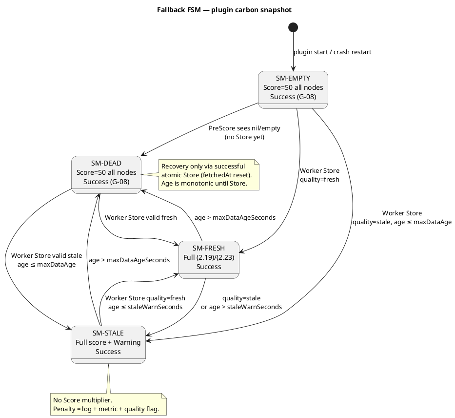

# Политика отказов, деградации и Fallback

- **Версия:** 1.1.0
- **Статус:** accepted (LOCKED)
- **Дата утверждения:** 2026-09-04
- **Владелец:** Reliability Engineer / SRE Architect
- **Уровень изменяемости:** L1
- **Основание:** [governance.md](governance.md) (`SCOPE-IN-09`, `SCOPE-EDGE-02`…`04`, `SCOPE-OUT-14`, `SCOPE-OUT-16`…`17`, `DOD-TEST-07`, `DOD-CODE-12`); [02_math_model_ssot.md](02_math_model_ssot.md) v1.0.0 LOCKED (G-06…G-12, G-20, G-21); [01_architecture_ssot.md](01_architecture_ssot.md) v1.1.0 LOCKED (`ARCH-01`…`ARCH-16`, §6, §14); [03_api_contracts_ssot.md](03_api_contracts_ssot.md) v1.0.1 LOCKED; [engineering-specification.md](engineering-specification.md) §§60–62, §77; [scheduler_framework_analysis.md](../research/scheduler_framework_analysis.md) §9.2; Freeze [`002_system_architecture_and_api_freeze.md`](../decisions_adr/002_system_architecture_and_api_freeze.md); Quality Gate 3
- **Канон полей REST/DTO/args/CycleState:** [`03_api_contracts_ssot.md`](03_api_contracts_ssot.md). Настоящий документ задаёт автомат Fallback и `fwk.Status` и **не** подменяет JSON-схемы.
- **Следующие потребители:** **Stage 5** (T5.2 / T5.3 — реализация автомата и тесты `DOD-TEST-07`); Stage 4 (last-good CDS)

> **LOCKED / SSOT Freeze (Quality Gate 3).** Документ — единственный нормативный источник матрицы сбоев, конечного автомата Fallback, контракта `fwk.Status` для углеродных отказов и правил Anti-Thrashing на этапе **первичного размещения**. Нормы `FF-*` **заблокированы**. Формулы (2.1)–(2.23) и предохранители G-01…G-21 **не переопределяются**. При расхождении: `governance.md` → ADR (`accepted`) → `02_math_model_ssot.md` → `01_architecture_ssot.md` → **этот файл** → `03_api_contracts_ssot.md` (`CONF-03`).

Документ отвечает на вопрос: **как система деградирует при любом отказе плоскости углеродных данных, не прерывая scheduling cycle Kubernetes.**

---

## 0. Нормативные идентификаторы

| ID | Норма (сжато) |
| --- | --- |
| FF-INV-01 | Никакой сбой Electricity Maps, CDS, кэша или невалидной \(CI\) **не** превращает ресурсно допустимый Pod в `Unschedulable` и **не** возвращает из `Score` код отличный от `Success` (`ARCH-09`, `SCOPE-IN-09`) |
| FF-INV-02 | Горячий путь `PreScore` / `Score` / `NormalizeScore` не выполняет HTTP, диск, `Wait` (`ARCH-01`, `SCOPE-OUT-17`) |
| FF-INV-03 | Углерод — критерий предпочтения, не допустимости (`ARCH-07`). `CarbonAware` не реализует `Filter` |
| FF-INV-04 | Dead cache / все зоны invalid → G-08: \(\operatorname{Score}(n)=\operatorname{Score}_{\mathrm{neutral}}=50\) **всем** узлам, не нейтрализация только \(S_C\) |
| FF-INV-05 | Неизвестная зона / невалидная \(CI\) узла → G-09 / G-10: \(S_C=S_C^{\mathrm{neutral}}=1/2\); \(S_R,S_P\) считаются; узел остаётся кандидатом |
| FF-INV-06 | Informal \(S_C=0\) **запрещён** как трактовка нейтрали. Канон: \(S_C^{\mathrm{neutral}}=1/2\), \(\operatorname{Score}_{\mathrm{neutral}}=50\) |
| FF-INV-07 | «Penalty Score» для stale-in-window **не** вводит множитель, смешение с нейтралью и не меняет (2.19)/(2.23). Penalty = warning + метрика + флаг качества |
| FF-INV-08 | `Score` при любом углеродном отказе возвращает валидный `fwk.NewStatus(fwk.Success)` (эквивалент `nil`) |
| FF-INV-09 | Единственный штатный `Error` плагина — hard SLA / неизвестный класс (G-12, G-20, `ARCH-10`). Это конфиг workload, не отказ источника \(CI\) |
| FF-INV-10 | Anti-Thrashing **размещения** = \(S_R\) (2.17) + serial assume + стандартный `Filter`. Relocation / descheduler / cooldown \(\Delta CF_{\min}\) — `SCOPE-OUT-14`, запрещены |
| FF-INV-11 | Resource exhaustion (нет места ни на одном узле) — ответственность стандартного `Filter`, не Fallback углерода. Плагин не вызывается либо no-op `Success` |
| FF-INV-12 | Публикация снимка CDS и снимка плагина — all-or-nothing; последний валидный снимок не затирается ошибкой сети |
| FF-INV-13 | Opt-out (`carbon-aware.io/enabled` отсутствует или `"false"`) → \(\operatorname{Score}=50\) всем, `Success`, `fallbackMode=opt_out`. **Не** G-08, **не** `fallback_total`, **не** hard SLA / G-20 (`ARCH-16`, `API-META-02`) |

---

## 1. Назначение и границы

### 1.1. Гарантия деградации

При любом сценарии отказа **плоскости углеродных данных** (провайдер, CDS, Worker, snapshot, метка зоны, NaN/\(CI<0\)) планировщик продолжает цикл: `Filter` → `PreScore` → `Score` → `NormalizeScore` → Bind. Вклад `CarbonAware` либо остаётся ранжирующим (fresh / stale-in-window), либо становится **константой 50** (dead), после чего argmax определяют остальные Score-плагины профиля (стратегия C) или ничья фреймворка (стратегия B).

Гарантия **не** обещает разместить Pod, когда стандартный `NodeResourcesFit` дал \(\mathcal{N}_{\mathrm{feas}}=\varnothing\). Это исчерпание ресурсов кластера, а не отказ углерода.

### 1.2. Что документ не вводит

| Запрет | Почему |
| --- | --- |
| Новая формула Score, \(\alpha(\mathrm{age})\), \(S_C\leftarrow 0\) | ADR-001 LOCKED |
| `Filter` / `Permit` / `QueueSort` / `Reserve` | `SCOPE-OUT-16`, `ARCH-04` |
| HTTP из `Score`/`PreScore` «на всякий случай» | `SCOPE-OUT-17` |
| Eviction, descheduler, live migration, cooldown relocation | `SCOPE-OUT-01`, `SCOPE-OUT-14`; spec §29 — не runtime |
| Endpoint CDS «вычисли Score» | `ARCH-03` |
| Redis / брокер / HA CDS | `SCOPE-OUT-06/10/19` |

---

## 2. Точки отказа системы

Два контура из `01_architecture_ssot.md` §3. Отказ контура A **не имеет права** останавливать контур B.

```text
[Electricity Maps] --HTTPS demo--> [CDS adapters]
                                      |
                                      v
                               [CDS in-memory cache]
                                      |
                               REST :8080
                                      |
                                      v
                         [Cache Sync Worker]  (вне scheduling cycle)
                                      |
                               atomic Store
                                      |
                                      v
                         [Plugin snapshot] --Load()--> PreScore --> CycleState --> Score
```

| ID | Компонент | Типичный отказ | Контур | Доходит ли до `Score` как I/O? |
| --- | --- | --- | --- | --- |
| FP-01 | Electricity Maps | timeout, 401/429/5xx, пустое тело | A (только CDS) | нет |
| FP-02 | Адаптер / Replay Engine | parse error, зона не в датасете, сдвиг \(t_{\mathrm{model}}\) | A | нет |
| FP-03 | CDS cache | холодный старт, процесс убит, частичная запись | A | нет |
| FP-04 | CDS REST | 404 зона, 400, 503, reset, медленный handler | A | нет (только Worker) |
| FP-05 | Cache Sync Worker | `httpTimeout`, DNS, 5xx, отмена `ctx` | A | нет |
| FP-06 | Plugin snapshot | `nil`, \(\mathrm{age}>\texttt{maxDataAgeSeconds}\) | граница A→B | нет I/O; ветка G-08 |
| FP-07 | Запись зоны | NaN, \(CI<0\), \(CI>2000\), \(\pm\infty\), timestamp из будущего | A, затем B | нет I/O; G-10 |
| FP-08 | Node label | нет `carbon-aware.io/zone`; зона есть, записи нет | B | G-09 |
| FP-09 | `CycleState` | нет ключа, гонка, пустая карта | B | нейтраль + `Success` |
| FP-10 | Арифметика PreScore | NaN в \(S_{\bullet}\) | B | G-21, не паника |
| FP-11 | Hard SLA / класс | \(\hat T>T_{\mathrm{deadline}}\), неизвестный class | B | `PreScore` **Error** (не FP углерода) |
| FP-12 | Resource exhaustion | \(\mathcal{N}_{\mathrm{feas}}=\varnothing\) | B, **Filter** | `CarbonAware` не вызывается |
| FP-13 | Prometheus | scrape down | C | нет влияния на `Status` |
| FP-14 | Crash scheduler | OOM, panic запрещён в плагине | процесс | kubelet restart; кэш холодный → G-08 |

Инвариант: единственный HTTP-клиент процесса планировщика к CDS — Worker (`ARCH-02`). `Score` читает только `CycleState`.

---

## 3. Часы, возраст и пороги

Возраст снимка плагина (канон `01_architecture_ssot.md` §6.3):

$$
\mathrm{age}_{\mathrm{snap}}
=
t_{\mathrm{now}}-t_{\mathrm{fetchedAt}},
\qquad
[\mathrm{age}_{\mathrm{snap}}]=\mathrm{s}.
$$

\(t_{\mathrm{now}}\) и \(t_{\mathrm{fetchedAt}}\) — **часы планировщика** (инжектируемый `Clock`, `DOD-TEST-01`). G-08 срабатывает при **обрыве sync**, а не из-за того, что в replay-датасете исторический `timestamp` записи «старый» относительно wall-clock.

Возраст записи зоны (валидация, не формула Score):

$$
\mathrm{age}_{\mathrm{rec}}(z)
=
t_{\mathrm{clock}}-t_{\mathrm{record}}(z).
$$

В replay \(t_{\mathrm{clock}}=t_{\mathrm{model}}\) CDS; Worker при успешном тике обновляет `fetchedAt`, даже если \(CI\) взята из прошлого ряда.

| Параметр | Default | Единица | Смысл |
| --- | --- | --- | --- |
| `refreshIntervalSeconds` | \(30\) | s | тик Worker |
| `httpTimeoutSeconds` | \(2\) | s | timeout HTTP Worker / CDS→провайдер |
| `maxDataAgeSeconds` | \(300\) | s | порог G-08 (`SCOPE-EDGE-04`) |
| `staleWarnSeconds` | \(90\) | s | вход в SM-STALE при \(\mathrm{age}_{\mathrm{snap}}>\texttt{staleWarnSeconds}\) |
| `clockSkewSeconds` | \(60\) | s | допуск «будущего» timestamp |

Нормы: `staleWarnSeconds` \(<\) `maxDataAgeSeconds`; `refreshIntervalSeconds` \(\ll\) `maxDataAgeSeconds`; все читаются из `pluginConfig.args` (`GO-12`). T3.2 обязан внести `staleWarnSeconds` и `clockSkewSeconds` в схему args; до этого — именованные константы с комментарием канона, не «магические 90».

Предикат «метка из будущего» (вход G-10, `DOD-TEST-04`):

$$
t_{\mathrm{record}}(z)
>
t_{\mathrm{clock}}+\texttt{clockSkewSeconds}
\;\Rightarrow\;
\text{запись invalid}.
$$

---

## 4. Матрица сбоев (Failure Matrix)

Колонка **`Score` Status** — контракт метода `Score` (и `NormalizeScore`). Колонка **`PreScore` Status** — отдельно, потому что SLA — не углеродный Fallback.

| ID | Сценарий | Детектор | Состояние автомата / предохранитель | `PreScore` | `Score` | Эффект на размещение |
| --- | --- | --- | --- | --- | --- | --- |
| FF-EM | Отказ Electricity Maps (live demo) | ошибка адаптера CDS | CDS **сохраняет** last-good, `quality=stale`; Worker может ещё pull | `Success` | `Success` | SM-STALE, пока \(\mathrm{age}_{\mathrm{snap}}\le\texttt{maxDataAgeSeconds}\); затем G-08. **Pods не блокируются** |
| FF-CDS | CDS недоступен (down, 5xx, timeout) | Worker HTTP error | **не** затирать plugin snapshot | `Success` | `Success` | снимок стареет → SM-STALE → SM-DEAD (G-08) |
| FF-CDS-COLD | CDS жив, кэш пуст (рестарт) | 503 / пустые зоны / Worker не собрал map | snapshot плагина `nil` или пустой | `Success` | `Success` | SM-EMPTY ≡ G-08 |
| FF-STALE | \(\texttt{staleWarnSeconds}<\mathrm{age}_{\mathrm{snap}}\le\texttt{maxDataAgeSeconds}\) или `quality=stale` | часы + флаг | SM-STALE | `Success` | `Success` | полный (2.19)/(2.23); Warning; метрика stale |
| FF-DEAD | \(\mathrm{age}_{\mathrm{snap}}>\texttt{maxDataAgeSeconds}\) | часы | SM-DEAD, G-08 | `Success` | `Success` | \(\operatorname{Score}=50\) всем; carbon не ранжирует; Resource Fit / прочие плагины |
| FF-EMPTY | snapshot никогда не публиковался | `Load()==nil` | SM-EMPTY, G-07→G-08 | `Success` | `Success` | как FF-DEAD |
| FF-NAN | NaN, \(\pm\infty\) | G-10 | зона как G-09; все зоны → G-08 | `Success` | `Success` | узел-кандидат; не `Error` |
| FF-NEG | \(CI<0\) или \(CI>2000\,\mathrm{gCO_2e}/\mathrm{kWh}\) | G-10 | как FF-NAN | `Success` | `Success` | как FF-NAN |
| FF-FUT | timestamp записи из будущего сверх skew | §3 | G-10 | `Success` | `Success` | как FF-NAN |
| FF-ZONE | нет label `carbon-aware.io/zone` | `SCOPE-EDGE-02` | G-09 | `Success` | `Success` | \(S_C=1/2\); \(S_R,S_P\) живы; узел не в (2.14) |
| FF-ZONE-404 | label есть, зоны нет в снимке (CDS 404) | отсутствие ключа map | G-09 | `Success` | `Success` | как FF-ZONE |
| FF-ALL-BAD | все узлы G-09/G-10 | после цикла по \(\mathcal{N}^{\star}\) | G-08 | `Success` | `Success` | как FF-DEAD |
| FF-NO-FC | нет forecast | G-06 | persistence (2.11) | `Success` | `Success` | **не** G-08; B и C могут разойтись |
| FF-OPT | Label `enabled` ≠ `"true"` (отсутствует или `"false"`) | `ARCH-16` | не автомат снимка; `opt_out` | `Success` | `Success` | Score=50 всем; **не** G-08; `fallback_total` не растёт |
| FF-SLA | \(\hat T>T_{\mathrm{deadline}}\) / нет class при **enabled** | G-12, G-20 | не автомат Fallback | **`Error`** | не вызывается | Pod `Pending`, backoff; **не** углеродный отказ |
| FF-RES | 100 % утилизация всех узлов (под не помещается) | стандартный `Filter` | вне плагина | не вызывается | не вызывается | `Unschedulable` от **Filter**, не от `CarbonAware` |
| FF-RES-ONE | «зелёная» нода 100 %, другие нет | `Filter` снимает только полные | SM без изменения | `Success` | `Success` | скоринг по \(\mathcal{N}_{\mathrm{feas}}\); AT-04 |
| FF-STATE | нет `carbonState` в `Score` | `Read` miss | дефект PreScore | — | **`Success`**, score \(50\) | попытка **не** срывается |
| FF-PROM | Prometheus down | экспорт best-effort | — | `Success` | `Success` | планирование живое (`ARCH-11`) |
| FF-CRASH | рестарт `carbon-aware-scheduler` | kubelet | холодный snapshot | `Success` | `Success` | SM-EMPTY до первого sync |

**Запрещённые кодировки** (любая строка матрицы, кроме FF-SLA):

- `fwk.Error`, `Unschedulable`, `UnschedulableAndUnresolvable`, `Wait`, `Pending` из `Score`;
- `Skip` из `PreScore` как замена G-08 (канон — явная константа 50, не «плагин отсутствует»);
- собственный carbon-`Filter`.

---

## 5. Конечный автомат Fallback

Автомат — **на Pod**, по одному `Load()` снимка (`ARCH-06`). Параллельные `Score` одного Pod видят одно и то же решение, уже записанное в `CycleState`.

### 5.1. Состояния снимка (cluster-wide)

| ID | Состояние | Предикат | Расчёт | Лог | Метрика (имена — [metrics.md](metrics.md)) |
| --- | --- | --- | --- | --- | --- |
| SM-EMPTY | Dead cache (холодный) | `snap==nil` или карта зон пуста | G-08: 50 всем | Warning, reason=`empty` | `fallback_total{reason="empty"}` |
| SM-FRESH | Fresh Data | валидный snap, `quality≠stale`, \(\mathrm{age}_{\mathrm{snap}}\le\texttt{staleWarnSeconds}\) | полный (2.19) или (2.23) | нет (V-уровень) | решения без fallback |
| SM-STALE | Stale Data in-window | валидный snap, \(\mathrm{age}_{\mathrm{snap}}\le\texttt{maxDataAgeSeconds}\) и (`quality=stale` **или** \(\mathrm{age}_{\mathrm{snap}}>\texttt{staleWarnSeconds}\)) | **тот же** полный Score | Warning, reason=`stale` | `stale_total` / `fallback_total{reason="stale"}` — **не** отключение carbon |
| SM-DEAD | Dead cache (протух) | \(\mathrm{age}_{\mathrm{snap}}>\texttt{maxDataAgeSeconds}\) | G-08: 50 всем | Warning, reason=`dead` | `fallback_total{reason="dead"}` |

SM-EMPTY и SM-DEAD **эквивалентны по Score** (G-08) и различаются только причиной для метрик и дипломного эксперимента №6.

### 5.2. Состояния узла (накладываются на SM-FRESH / SM-STALE)

| ID | Предикат | Действие |
| --- | --- | --- |
| NM-OK | зона есть, запись G-10-valid | \(\widehat{CF}\) / \(CI\) участвуют в (2.14) или (2.23) |
| NM-UNKNOWN | нет label зоны **или** зоны нет в snap | G-09: \(S_C=1/2\); \(\widehat{CF}\) **не** в (2.14); \(S_R,S_P\) считаются |
| NM-INVALID | запись зоны не проходит G-10 / FF-FUT | как NM-UNKNOWN (G-10 → G-09) |
| NM-NAN-SCORE | NaN в промежуточном \(S_{\bullet}\) | G-21: как G-09; не `panic` (`GO-06`) |

Если после разметки **все** \(n\in\mathcal{N}^{\star}\) суть NM-UNKNOWN или NM-INVALID → перейти к SM-DEAD (G-08) для этого Pod.

В режиме `scoringMode: current-ci` (стратегия B) NM-UNKNOWN даёт \(S_B=1/2\) (вторая ветвь (2.23) на вырождении шкалы — отдельно; для одного узла без \(CI\) не включать его в \(CI_{\min}/CI_{\max}\)).

### 5.3. Диаграмма автомата снимка



Переходы Store выполняет **только** Worker, не `PreScore`. `PreScore` классифицирует уже опубликованный указатель.

### 5.4. Диаграмма решения PreScore → Score

```plantuml
@startuml fallback_prescore_score
title PreScore classification and Score Success invariant
skinparam shadowing false
autonumber

start
if (invalid enabled / wrong surface?) then (yes)
  :PreScore Error\nSLA precondition failed;
  stop
endif
if (enabled ≠ true?) then (FF-OPT)
  :write Score=50 for every node\nfallbackMode=opt_out;
  :PreScore Success;
  stop
endif
if (G-12 / G-20 SLA or class?) then (yes)
  :PreScore Error\nSLA precondition failed;
  stop
endif
:snap := snapshot.Load()  (once);
if (snap nil OR empty OR age > maxDataAge\nOR all nodes NM-INVALID/UNKNOWN?) then (G-08)
  :write Score=50 for every node;
  :metric fallback_total;
  :PreScore Success;
else (FRESH or STALE)
  if (STALE?) then (yes)
    :Warning + stale metric;
  endif
  :compute (2.19) or (2.23)\nwith G-06, G-09, G-10, G-21;
  :write immutable carbonState;
  :PreScore Success;
endif
fork
  :Score(node): lookup O(1);
  if (key missing?) then (yes)
    :return (50, Success);
  else (no)
    :return (s_fp, Success);
  endif
fork again
  :NormalizeScore: rnd/100, clamp (2.21);
  :return Success;
end fork
stop

@enduml
```

---

## 6. Отображение формулировок задачи на канон

| Формулировка задания | Канон реализации | Запрещённая трактовка |
| --- | --- | --- |
| Fresh Data → Full Multi-Objective Score | SM-FRESH: (2.19) default C; (2.23) если `current-ci` | считать Fresh только при live Electricity Maps |
| Stale Data (\(<\texttt{maxDataAge}\)) → Penalty Score / Log Warning | SM-STALE: **полный** Score + Warning + флаг `dataStale` в `CycleState` | \(\operatorname{Score}\leftarrow (1-\alpha)\operatorname{Score}+\alpha\cdot 50\); штраф \(S_C\) |
| Dead Cache → Neutral Carbon Score (\(S_C=0\) / Fallback to Resource Fit) | G-08: \(\operatorname{Score}_{\mathrm{neutral}}=50\) **всем**; \(S_C^{\mathrm{neutral}}=1/2\) **не** используется как «выключить только углерод». Resource Fit = остальные плагины профиля C (`NodeResourcesFit` Score) либо ничья B | \(S_C=0\) одному/всем узлам; `Unschedulable`; `Skip` |
| Unknown Zone → Neutral Carbon Score | G-09: \(S_C=1/2\), узел в \(\mathcal{N}^{\star}\), не в (2.14) | `Filter` Unschedulable; Score=0 как отсев |

Смысл «Fallback to Resource Fit»: при G-08 вклад `CarbonAware` **одинаков** для всех кандидатов, поэтому \(\operatorname{argmax}_n\operatorname{TotalScore}(n)\) (2.22) совпадает с argmax без углеродного плагина. Это и есть возврат к baseline behaviour (`SCOPE-IN-09`). \(S_R\) внутри плагина при G-08 **не** считается отдельно: иначе профиль C не вернулся бы к baseline (T1.3 §9.2).

---

## 7. Алгоритм Fallback плагина (норматив для T5.2)

Псевдокод. Имена типов — ориентир; канон полей — T3.2.

### 7.1. Классификация снимка

```text
classify(snap, now) -> (mode, reason)
  if snap == nil OR len(snap.zones) == 0:
      return SM-EMPTY, "empty"
  age = now - snap.fetchedAt
  if age > maxDataAgeSeconds:
      return SM-DEAD, "dead"
  if snap.quality == stale OR age > staleWarnSeconds:
      return SM-STALE, "stale"
  return SM-FRESH, "fresh"
```

`quality=stale` выставляет Worker, если CDS отдал last-good после ошибки провайдера / 503 freshness, **даже** при только что обновлённом `fetchedAt`.

### 7.2. `PreScore`

Порядок обязателен (`01_architecture_ssot.md` §6.4):

0. Разобрать `WorkloadProfile`. Невалидные ключи / значение `enabled` не из `{true,false}` → `return fwk.NewStatus(fwk.Error, "SLA precondition failed")`.
0a. Если `enabled≠true` (FF-OPT): для каждого узла \(s^{\mathrm{fp}}=5000\); `fallbackMode=opt_out`; `optInDisabled=true`; **не** инкрементировать `fallback_total`; `return fwk.NewStatus(fwk.Success)`. Snapshot не требуется.
1. Hard SLA / класс (G-12, G-20): при нарушении `return fwk.NewStatus(fwk.Error, "SLA precondition failed")`. Метрика `sla_rejection_total`. **Не** инкрементировать `fallback_total`.
2. `snap := snapshot.Load()` ровно один раз.
3. `mode, reason := classify(snap, clock.Now())`.
4. Если `mode ∈ {SM-EMPTY, SM-DEAD}`: для каждого узла записать fixed-point \(s^{\mathrm{fp}}=5000\) (то есть \(\operatorname{Score}=50\)); `dataStale=true`; `fallbackMode=reason`; `return fwk.NewStatus(fwk.Success)`.
5. Иначе для каждого \(n\): зона, G-10/FF-FUT, G-09, \(u^{\pm}\), \(\widehat{P}_{\mathrm{pod}}\), (2.10s) или (2.23), G-06 если нет forecast, G-21.
6. Если все узлы NM-UNKNOWN/NM-INVALID: выполнить шаг 4 с `reason="all_invalid"` (G-08).
7. \(CF_{\min},CF_{\max}\) **без** узлов G-09; (2.15)–(2.19) либо (2.23); G-04/G-05.
8. `state.Write(carbonStateKey, immutable carbonState)`.
9. Если `mode==SM-STALE`: Warning (rate-limit: не чаще одного сообщения на пару `(fetchedAt, reason)`).
10. `return fwk.NewStatus(fwk.Success)`.

Паника запрещена. HTTP запрещён.

### 7.3. `Score` — инвариант Success

```text
Score(ctx, state, pod, nodeInfo) -> (int64, *fwk.Status)
  data, err := state.Read(carbonStateKey)
  if err != nil OR data == nil:
      return 50, fwk.NewStatus(fwk.Success)   # FF-STATE; не Error
  s, ok := data.scorePerNode[nodeInfo.Node().GetName()]
  if !ok:
      return 50, fwk.NewStatus(fwk.Success)
  return s, fwk.NewStatus(fwk.Success)
```

Нормы:

- нет второго `snapshot.Load()`;
- нет аллокаций карт;
- **любая** ветка возвращает `fwk.NewStatus(fwk.Success)`. Код `nil` эквивалентен Success в фреймворке (T1.3 §10); реализация T5.2 **обязана** в unit-тесте проверять `status.IsSuccess()` на всех строках матрицы §4, кроме FF-SLA (там `Score` не зовут).
- запрещено возвращать `Error`, чтобы «сигнализировать о качестве данных»: качество — метрика и флаг `carbonState`, не `Status`.

### 7.4. `NormalizeScore`

(2.21): \(\operatorname{rnd}(s^{\mathrm{fp}}/100)\), затем \(\operatorname{clamp}(\cdot,0,100)\). Всегда `Success`. G-19 закрывает численный выброс **клампом**, а не `Error`. Проверка фреймворка после нормализации не должна увидеть значение вне \([0,100]\); если увидит — это дефект плагина, проявляющийся как срыв цикла (T1.3 §7.1). Тесты T5.2 обязаны сделать этот путь недостижимым.

### 7.5. Поля `carbonState` (минимум для T3.2)

Неизменяемо после `Write` (T1.3 §5.4):

| Поле | Назначение |
| --- | --- |
| `scorePerNode map[string]int64` | fixed-point, lookup `Score` |
| `fallbackMode` | `fresh` \| `stale` \| `dead` \| `empty` \| `all_invalid` \| `opt_out` |
| `dataStale bool` | `true` для SM-STALE, SM-DEAD, SM-EMPTY |
| `zonesMissing int` | число NM-UNKNOWN |
| `invalidZones int` | число NM-INVALID |

`Clone()` возвращает тот же указатель (имmutable).

---

## 8. Деградация CDS и Worker (норматив для T5.3)

### 8.1. CDS

| Событие | Действие | Запрещено |
| --- | --- | --- |
| Ошибка Electricity Maps / адаптера | оставить last-good map; пометить `quality=stale`; `/api/v1/health` отражает staleness | отдать 500 на `/current` так, чтобы Worker затёр плагин; очистить кэш |
| Невалидная запись (G-10, FF-FUT) | не класть в map; если после тика **ни одной** валидной зоны — не публиковать новый map | частичный publish «north обновлён, west дырка без метки stale» |
| GET `/zones/{zone}/current` неизвестная зона | **404**; плагин (через Worker) трактует как G-09, не как падение | 500 |
| Нет forecast | 200 и пустой массив; persistence делает **плагин** (G-06) | подставлять будущие actual (`perfect foresight`) |
| Рестарт процесса | кэш холодный; health not-ready по freshness | диск как обязательный persistence (`SCOPE-OUT-10`) |

All-or-nothing: новый map собирается целиком, затем атомарная замена. Обработчики REST имеют `context` timeout (`GO-09`). CDS **не** ранжирует узлы и **не** вызывает kube-apiserver.

Live Electricity Maps — только demo (`SCOPE-EDGE-06`). Зачётный прогон — replay; FF-EM в эксперименте моделируется **отключением адаптера / mock error**, не реальным API.

### 8.2. Cache Sync Worker

Алгоритм (`01_architecture_ssot.md` §6.2) дополняется правилами надёжности:

1. Тик `refreshIntervalSeconds`.
2. `GET /api/v1/zones` с `httpTimeoutSeconds`. Любая ошибка / не-200 → **не** `Store`; `sync_failure_total`; выход из тика.
3. Для каждой зоны `current` + `forecast`. Если **хотя бы один** обязательный GET тика неуспешен → **не** `Store` (нет смеси old/new зон).
4. Валидация G-10 + FF-FUT. Сборка нового immutable `carbonSnapshot`.
5. Если после валидации 0 зон → **не** `Store` (оставить предыдущий, он состарится до G-08).
6. Иначе `Store`; `fetchedAt=clock.Now()`; `quality` с CDS (если CDS `stale` — snapshot `stale`).
7. Не вызывать из `PreScore`/`Score`. Нет `Wait` «кэш готов» на горячем пути.

---

## 9. Контракт `fwk.Status` (проверка задания)

| Метод | Углеродный отказ (все FF-* кроме FF-SLA) | FF-SLA | Resource exhaustion |
| --- | --- | --- | --- |
| `PreScore` | `fwk.NewStatus(fwk.Success)` | `fwk.NewStatus(fwk.Error, "SLA precondition failed")` | не вызывается, если \(\mathcal{N}_{\mathrm{feas}}=\varnothing\) |
| `Score` | **всегда** `fwk.NewStatus(fwk.Success)` + `int64` в допустимом fixed-point | не вызывается | не вызывается |
| `NormalizeScore` | `fwk.NewStatus(fwk.Success)`, значения в \([0,100]\) | не вызывается | не вызывается |

Следствие для реализации и тестов T5.2: таблица `DOD-TEST-07` считает тест проваленным, если `Score` вернул `status.Code() != fwk.Success` (включая `nil`-проверку: `nil` допустим как Success, но тогда `status.IsSuccess()` обязана быть истинной в хелпере теста).

`Error` из `PreScore`/`Score` **отклоняет попытку** (T1.3 §9.2). Поэтому качество \(CI\) кодируется состоянием и метрикой, никогда кодом ошибки фреймворка.

---

## 10. Anti-Thrashing

Различаются **два** разных явления. Смешивать их в коде запрещено.

### 10.1. Что запрещено (`SCOPE-OUT-14`, spec §29)

Relocation anti-thrashing: \(\Delta CF_{\min}\), \(T_{\mathrm{cooldown}}\), eviction, descheduler, повторное размещение уже запущенного Pod. Это **не** runtime диплома.

`CarbonAware` не реализует `Reserve` / `Unreserve` / preemption (`ARCH-04`).

Не вводятся: счётчик «уже посадили N Pod в зелёную зону» вне `NodeInfo`, hysteresis по зоне, token bucket, `QueueSort` для батчевания.

### 10.2. Что входит в Scope: anti-concentration первичного размещения

Массовый поток Pod на одну «зелёную» ноду ограничивается **уже существующими** механизмами Kubernetes и модели.

| ID | Правило | Механизм |
| --- | --- | --- |
| AT-01 | Мягкое растекание нагрузки | \(S_R=1-U_{\mathrm{node}}\) (2.17), \(\lambda=1\) CPU-only; не заменяет `Filter` |
| AT-02 | Цикл планирования **последователен** по Pod | следующий Pod видит `NodeInfo.GetRequested()` **включая assumed** Pod (`T1.3` §6.2) |
| AT-03 | Жёсткий потолок перегрузки | стандартный `NodeResourcesFit` в `Filter`: не влезает → узел не в \(\mathcal{N}_{\mathrm{feas}}\) |
| AT-04 | Полная «зелёная» нода не блокирует остальные | FF-RES-ONE: скоринг только по оставшимся; высокая \(CI\) не `Unschedulable` |
| AT-05 | 100 % всех нод | FF-RES: `Unschedulable` от Filter; углерод ни при чём |
| AT-06 | G-08 снимает «магнит» зелёной зоны | все кандидаты с \(\operatorname{Score}=50\); нет carbon-концентрации |
| AT-07 | Стратегия C | \(w_R>0\) (default \(0{,}2\)) + стандартные Score-плагины профиля, включая `NodeResourcesFit` |
| AT-08 | Стратегия B | \(w_R=0\), прочие Score выключены: концентрация на минимуме \(CI\) до насыщения Filter — **принятое** свойство baseline B, не дефект T5.2 |
| AT-09 | Запрет carbon-`Filter` даже при burst | иначе \(\mathcal{N}_{\mathrm{feas}}\) разойдётся у A и C (`ARCH-07`) |
| AT-10 | Один снимок \(CI\) на Pod | Worker не меняет ранжирование «на лету» внутри попытки (`ARCH-06`) |

Следствие AT-08: в тексте диплома и в карточке эксперимента B нельзя требовать равномерного fill зелёных/грязных зон — алгоритм B это не обещает.

### 10.3. Почему \(w_C=0{,}6\) не отменяет AT-01

Пример (гипотеза порядка, не KPI): север \(S_C=1\), \(u^+=0{,}9\) → \(S_R=0{,}1\); запад \(S_C=0\), \(u^+=0{,}1\) → \(S_R=0{,}9\); \(S_P=1\); веса default. \(\operatorname{Score}_{\mathrm{north}}=82\), \(\operatorname{Score}_{\mathrm{west}}=38\). Углерод ещё побеждает — это углеродо-ориентированный режим. Когда север не проходит `Filter`, запад становится единственным кандидатом. **Жёсткая** защита от перегрузки — AT-03, не понижение \(S_C\).

Вводить дополнительный штраф «зелёной» ноде сверх (2.17) запрещено без ADR: это новая формула.

### 10.4. Anti-flapping самого Fallback

\(\mathrm{age}_{\mathrm{snap}}\) монотонен до успешного `Store`. Возврат SM-DEAD → SM-FRESH только после валидной публикации. Порог `maxDataAgeSeconds` **не** окружается гистерезисом: достаточно атомарности Worker. Запрещено задерживать возврат к carbon scoring «на всякий случай» (это удлиняло бы baseline и портило эксперимент отказа).

Логи Warning: не чаще одного раза на `(fetchedAt, reason)` на процесс, чтобы burst Pod не затопил klog.

---

## 11. Наблюдаемость (канон имён — [metrics.md](metrics.md))

Имена зафиксированы Quality Gate 3; **смысл обязателен**.

| Смысл | Когда |
| --- | --- |
| `fallback_total{reason}` | SM-EMPTY, SM-DEAD, `all_invalid` (G-08). **Не** смешивать со SM-STALE, если нужен раздельный Fallback rate эксперимента №6 |
| `stale_in_window_total` | SM-STALE (полный Score) |
| `sla_rejection_total` | только FF-SLA |
| `sync_failure_total` | Worker не Store |
| `invalid_record_total` | G-10 / FF-FUT на границе CDS или Worker |
| `unknown_zone_nodes` | gauge или counter NM-UNKNOWN |
| `snapshot_age_seconds` | \(\mathrm{age}_{\mathrm{snap}}\) |
| `cds_provider_error_total` | FP-01/FP-02 |
| `opt_out_total` | FF-OPT; **не** смешивать с G-08 |

Экспорт метрик best-effort: ошибка Prometheus **не** меняет `Status` (`01_architecture_ssot.md` §7.3).

---

## 12. Обязательные тесты (T5.2 / T5.3, `DOD-TEST-07`)

Каждый кейс: инжекция часов, без внешней сети.

| Кейс | Ожидание |
| --- | --- |
| Electricity Maps / provider error, last-good моложе `maxDataAge` | `Score` Success; режим STALE или FRESH по `quality`; Pod не `Unschedulable` |
| CDS down, snapshot старше `maxDataAge` | G-08, Success, все scores 50 |
| Холодный snapshot | G-08, Success |
| \(\mathrm{age}\) в `(staleWarn, maxDataAge]` | полный Score ≠ константа 50 (если зоны различаются), Warning/метрика stale |
| NaN / \(CI=-1\) / \(CI=+\infty\) / future timestamp | узел G-09; Success; при всех invalid — G-08 |
| Нет label зоны | G-09, узел в списке scores |
| 404 зоны | G-09 |
| Нет forecast | persistence, не G-08 |
| `Score` без `carbonState` | `(50, Success)` |
| Prometheus недоступен | Success (integration: экспорт падает, цикл жив) |
| SLA fail | `PreScore` Error; `fallback_total` не растёт |
| Opt-out (`enabled` отсутствует / `"false"`) | Score=50, Success, `fallback_total` не растёт |
| Все ноды ресурсно полны | `CarbonAware` не делает Pod «ещё более» Unschedulable; статус от Filter |
| Burst  N Pod на одну зелёную зону (C) | `GetRequested` растёт; после насыщения Filter уходит на другую ноду; нет eviction |
| G-08 не использует `Skip` | в `CycleState` явные 50 |

Оракулы §14 математики остаются тестами **happy path**; настоящий раздел — ортогонален (`DOD-TEST-04` граничные \(CI\)).

---

## 13. Отклонённые альтернативы

| Альтернатива | Почему отклонена |
| --- | --- |
| \(S_C=0\) при dead/unknown | противоречит G-04/G-08/G-09 (\(1/2\) и Score 50 всем) |
| Множитель свежести \(\alpha(\mathrm{age})\) в (2.19) | новая формула, нужен ADR; ломает сравнение A/B/C |
| `PreScore` `Skip` вместо 50 | не G-08; хуже наблюдаемость |
| `Error` / `Unschedulable` при stale CDS | ломает `SCOPE-IN-09`, выглядит как сбой планировщика |
| HTTP retry из `PreScore` | `SCOPE-OUT-17`, стоп всего кластера на timeout |
| Carbon `Filter` «грязных» зон | `ARCH-07`; при отказе всех зон — полный стоп планирования |
| `Reserve` слот на зелёной ноде | `ARCH-04`, отдельный ADR |
| Cooldown relocation spec §29 | `SCOPE-OUT-14` |
| Синхронный Extender к CDS | `SCOPE-OUT-08`, ADR-002 |

---

## 14. Трассировка к Scope и архитектуре

| Норма | Где закрыта |
| --- | --- |
| `SCOPE-IN-09` | §5–§7 цепочка fresh → stale-in-window → G-08 → baseline |
| `SCOPE-EDGE-02` | FF-ZONE, G-09 |
| `SCOPE-EDGE-03` | FF-NO-FC, G-06 |
| `SCOPE-EDGE-04` | FF-DEAD, G-08 |
| `SCOPE-OUT-14` | §10.1 |
| `SCOPE-OUT-16/17` | FF-INV-02/03, §7 |
| `ARCH-09` / `ARCH-10` / `ARCH-16` | §9, FF-OPT |
| `DOD-TEST-07` | §12 |
| Experiment №6 (spec §77) | матрица §4 + метрики §11 |

---

## 15. Передача T5.2 / T5.3

### 15.1. T5.2 — плагин (`pkg/scheduler`)

Реализовать `classify`, ветки SM-*, G-08/G-09/G-10/G-21, инвариант `Score` → Success, rate-limited Warning, поля `carbonState`. Не ходить в сеть. Не менять (2.19). Не добавлять Reserve.

Правила Fallback для кода — §7 целиком и таблица §6.

### 15.2. T5.3 — CDS + Worker + failure-тесты

Реализовать last-good + `quality=stale`, all-or-nothing publish, 404≠500, Worker «ошибка тика → нет Store», тесты §12. Не блокировать readiness планировщика ожиданием CDS.

### 15.3. Контракты закрыты (Quality Gate 3)

REST/DTO: [`03_api_contracts_ssot.md`](03_api_contracts_ssot.md) v1.0.1 LOCKED. Имена метрик: [`metrics.md`](metrics.md) v1.0.0 LOCKED. Fallback rate эксперимента не смешивает SM-STALE и G-08 без лейбла `reason`; opt-out не входит в `fallback_total`.

### 15.4. Что не переоткрывать

- HTTP в `Score`;
- \(S_C=0\) как нейтраль;
- carbon-`Filter`;
- relocation anti-thrashing;
- правку G-06…G-10.
